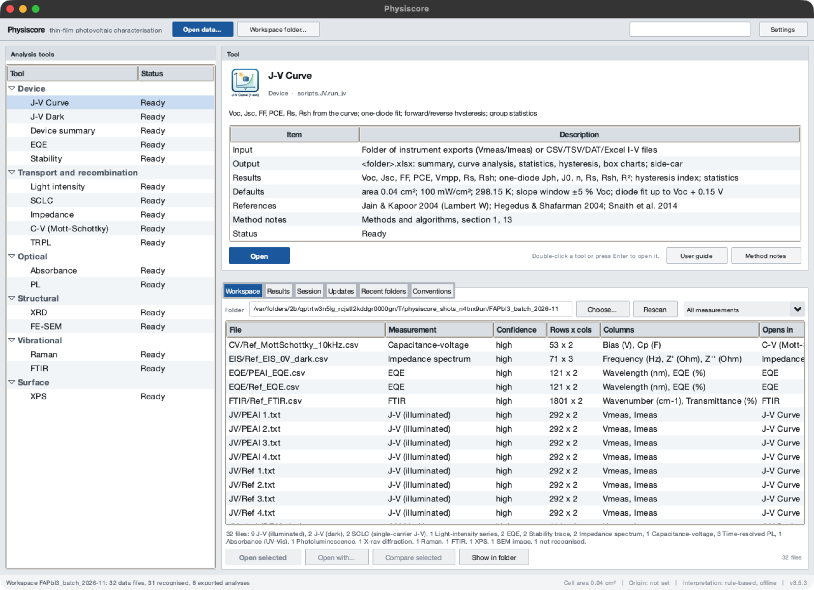
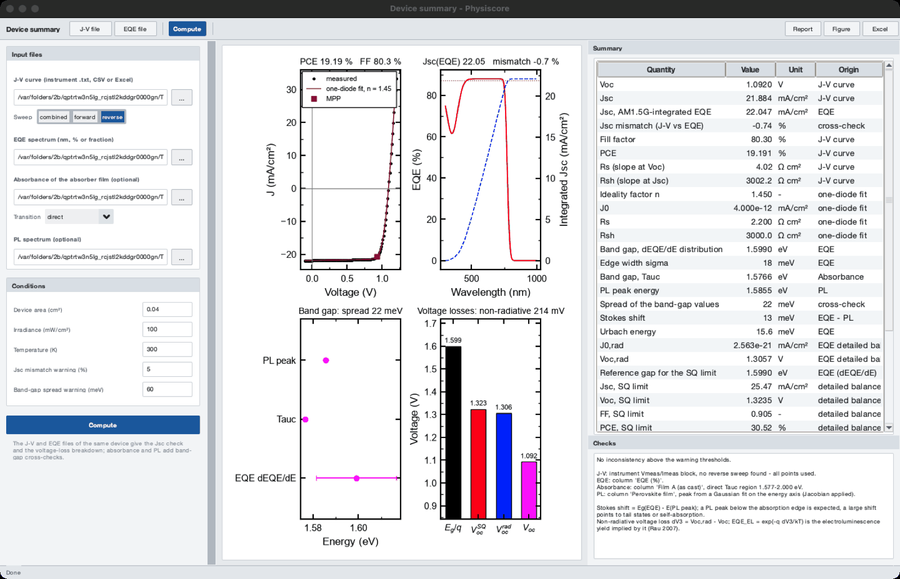
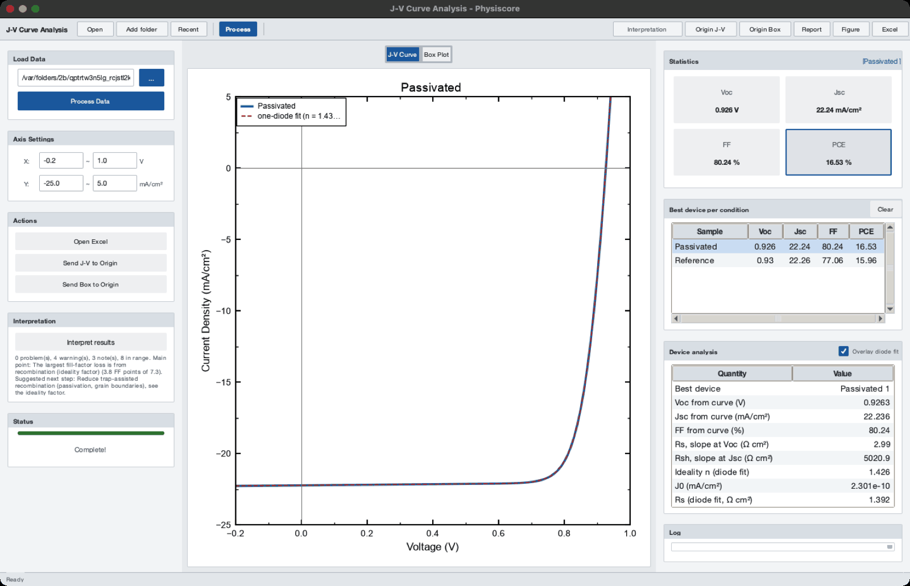
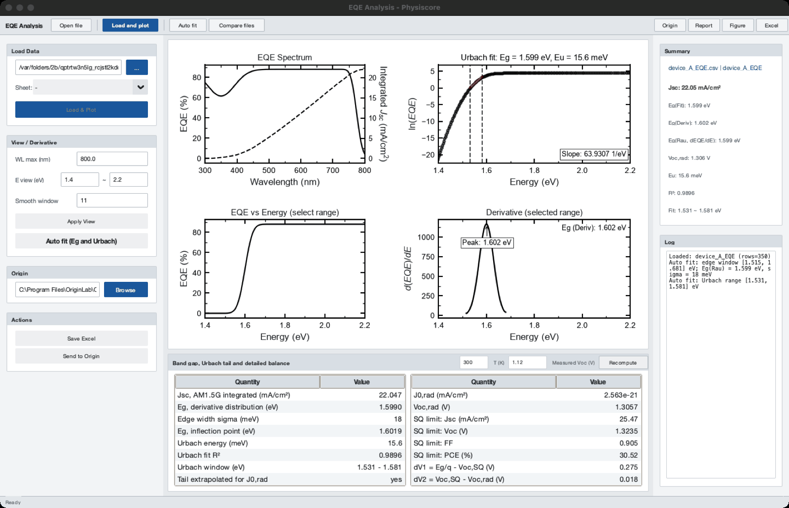
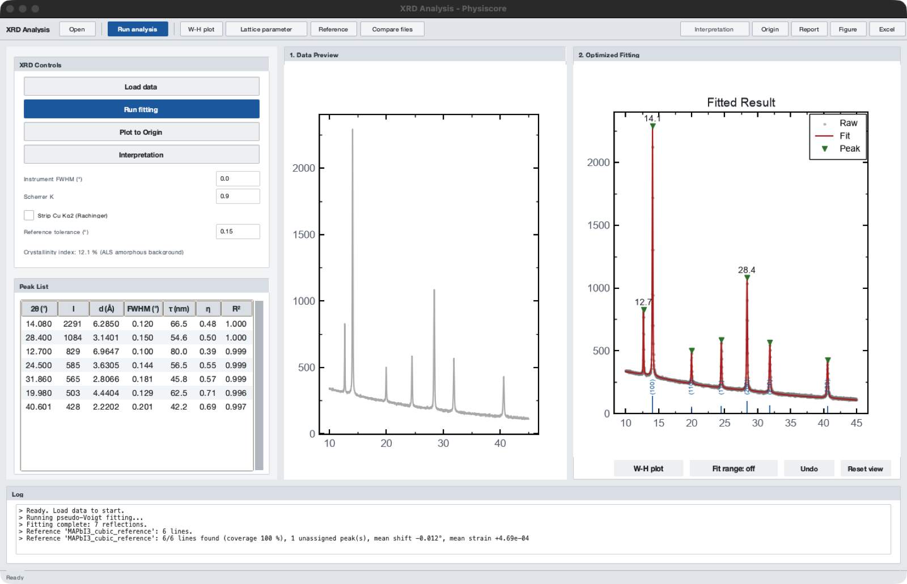
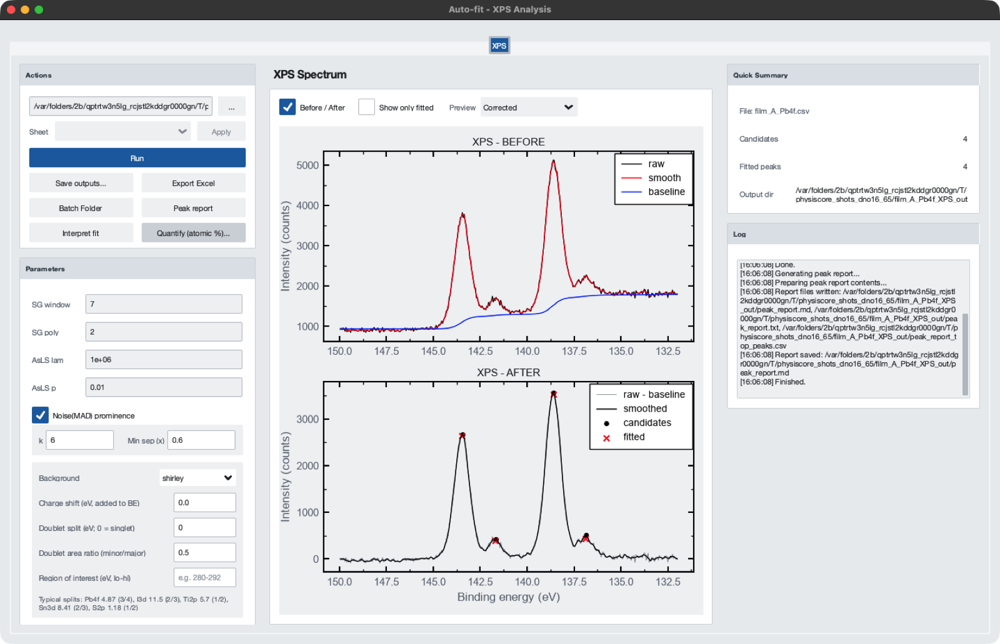
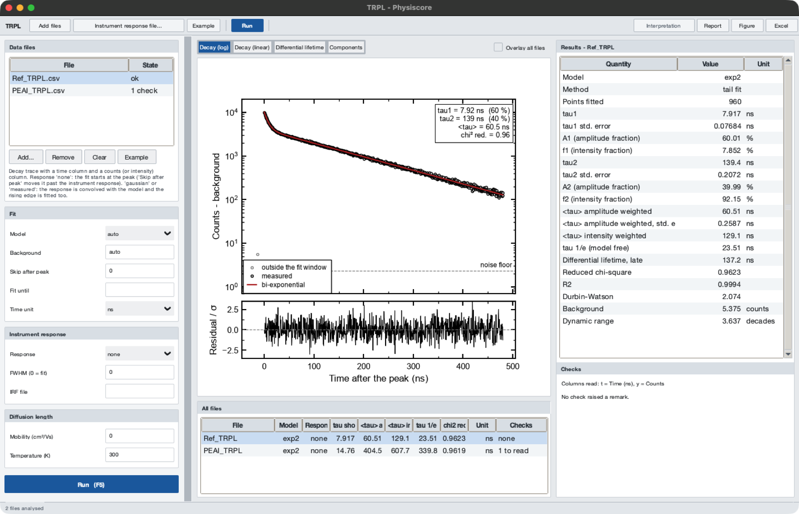
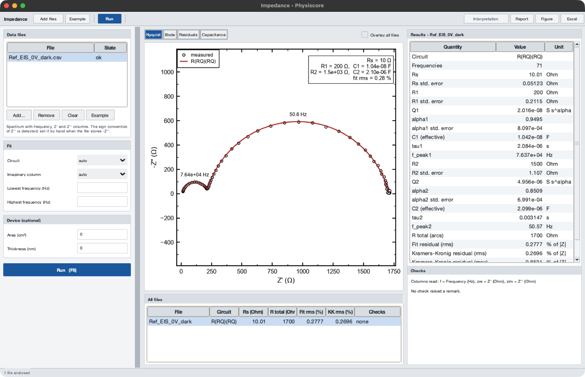
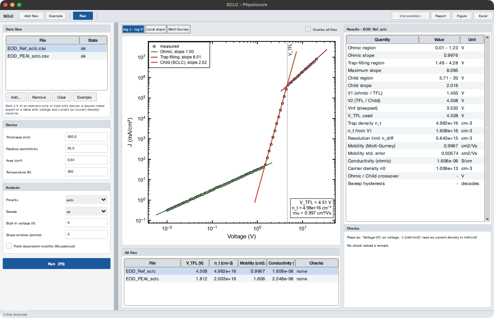
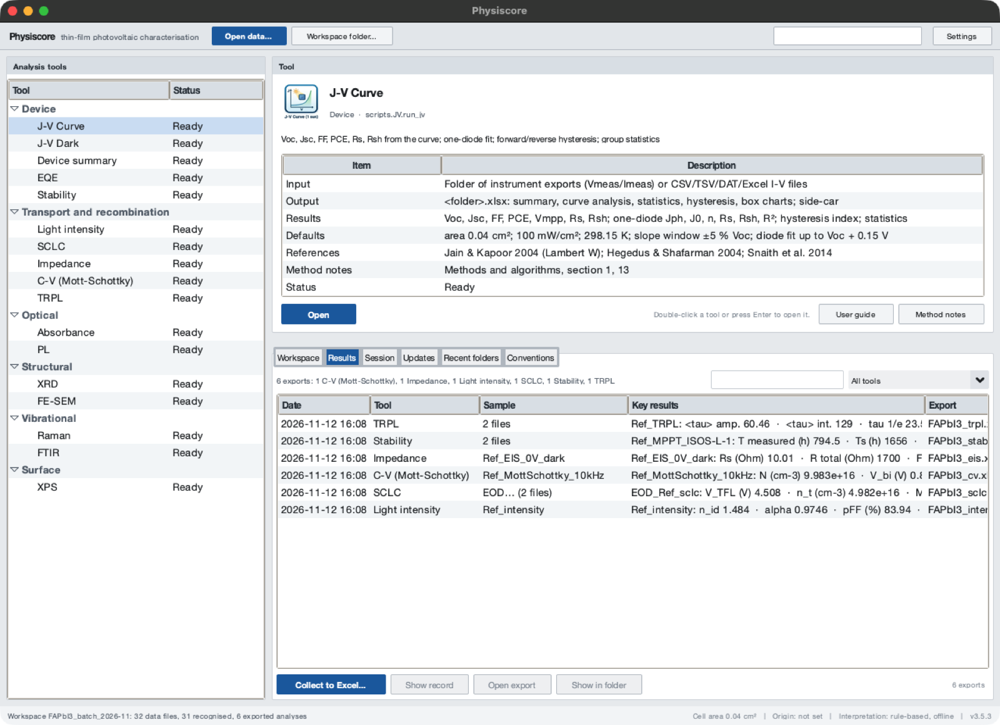

# Physiscore

[](https://github.com/jongsu-king/physiscore/actions/workflows/ci.yml)
[](https://doi.org/10.5281/zenodo.22267588)

**Physics-constrained analysis of thin-film photovoltaic device and material
characterisation: sixteen measurement techniques, one set of conventions, cross-checks
between them, and every number traceable to an equation, a test and a side-car file.**

Physiscore recomputes device and material parameters from the measured curves rather
than copying an instrument's summary block, applies the standard physical models
(one-diode equivalent circuit, detailed balance, Tauc/Urbach, Scherrer/Williamson–Hall,
Shirley background, Mott–Gurney, Mott–Schottky, equivalent circuits with a Kramers–Kronig
test …) with stated defaults, and reports each quantity with its fit
quality. The algorithms are documented with equations and references in
[docs/METHODS.md](docs/METHODS.md) and validated against closed-form synthetic data in
[docs/VALIDATION.md](docs/VALIDATION.md).

| Technique | Derived quantities |
|---|---|
| **J–V (light)** | Voc, Jsc, FF, PCE, Vmpp, Rs, Rsh from the curve; one-diode fit (Jph, J0, n, Rs, Rsh); forward/reverse hysteresis index; group statistics; Jsc mismatch vs EQE |
| **J–V (dark)** | ideality factor n and J0 (sliding window), Rsh,dark, full one-diode fit with Rs, Cheung dV/dlnJ |
| **EQE** | AM1.5G-integrated Jsc (ASTM G173-03), Eg from dEQE/dE (Rau), Urbach energy, J0,rad, Voc,rad, Shockley–Queisser limits, ΔV1/ΔV2/ΔV3 loss breakdown |
| **Absorbance** | Tauc band gap with automatic linear region and standard error, derivative Eg, Urbach energy; A or α basis |
| **XRD** | ALS background, simultaneous pseudo-Voigt fitting, d-spacing, Scherrer (instrument-corrected), Williamson–Hall with uncertainties, Kα2 stripping, crystallinity index, cubic lattice parameter (Nelson–Riley) |
| **PL** | Savitzky–Golay + ALS, Gaussian/Voigt single or AIC-selected multi-component fits, energy axis with Jacobian, FWHM in nm and meV, quenching efficiency |
| **Raman / FTIR** | arPLS/ALS baselines, band detection and Lorentzian/Gaussian fitting, peak-shift tables, band library, T↔A |
| **SEM** | watershed grain segmentation, size distribution with D10/D50/D90 and log-normal fit |
| **XPS** | Shirley background, Voigt singlet/doublet fitting, charge referencing, atomic concentration |
| **Light intensity** | ideality factor from Voc against ln(irradiance) with its error, Jsc ∝ I^α, Suns-Voc pseudo J-V, pseudo fill factor and the transport loss, local ideality |
| **SCLC** | ohmic, trap-filling and Child regimes from the local slope, V_TFL and trap density with its resolution limit, Mott–Gurney mobility (optionally Murgatroyd), conductivity and n0, sweep hysteresis |
| **Impedance** | complex least-squares fit of R(RC), R(RQ), R(RC)(RC) or R(RQ)(RQ) chosen by AICc, parameter errors, time constants, effective capacitance, linear Kramers–Kronig test |
| **C–V (Mott–Schottky)** | straight section of 1/C² found automatically, doping density, built-in voltage, depletion width, doping profile N(W), full-depletion limit N_min |
| **TRPL** | one to three exponentials or a stretched exponential chosen by AICc (Poisson weights for counts), amplitude- and intensity-weighted mean lifetimes, τ(1/e), differential lifetime, diffusion length |
| **Stability** | T80 (measured, or extrapolated and marked as such), burn-in amplitude and time constant, stabilised Ts80, loss rate per 1000 h, ISOS protocol on record |
| **Device summary** | J-V + EQE (+ absorbance, PL) of one device: Jsc cross-check, band gap from three techniques, Voc vs Voc,rad and Voc,SQ with the loss breakdown, fractions of the SQ limits |

**Interpretation** in every window turns the results into findings by explicit rules -
fill-factor loss split, ideality regime, statistics between conditions, voltage losses,
Williamson–Hall strain, secondary phases, metallic lead in XPS, trap density against its
resolution limit, Kramers–Kronig validity of an impedance spectrum, an extrapolated T80
and more - each with its evidence, threshold, reference and next step. It runs offline,
needs no account and gives the same text for the same data
([METHODS §16](docs/METHODS.md#16-rule-based-interpretation-scriptscommoninterpretpy-interpret_transportpy)).

**Open data** reads a file, recognises the measurement from its name, column headers and
numbers, and opens it in the right tool; **Workspace folder** lists a whole project that
way, and the **Results** tab collects the key numbers of everything exported below that
folder into one table (and one Excel workbook). The recognition is a list of scored
rules ([METHODS §23](docs/METHODS.md#23-measurement-detection-and-the-results-index)).
Every graph has a data reader, a plot-details dialog, a data worksheet and a figure
export at journal column widths.

Many files at once: *Compare files* in the spectroscopy tools and `physiscore batch` on the
command line tabulate whole series; XRD patterns can be matched against reference peak
lists; J-V curves can come from instrument text exports or from CSV/Excel files.

## Screenshots

All screenshots show synthetic example data (analytical models with noise), produced by
`python tools/screenshots.py`; the user guide explains every window.

| | |
|---|---|
|  |  |
| Main window: tool tree, the selected tool's input, output and method notes, and the measurements found in a project folder | Device summary: J-V, EQE, absorbance and PL of one device, Jsc cross-check, band gaps, voltage-loss ladder |
|  |  |
| J-V: curve-derived parameters, one-diode fit, best device per condition | EQE: AM1.5G Jsc, Rau band gap, Urbach tail, detailed balance |
|  |  |
| XRD: pseudo-Voigt fit, reference peak list with hkl ticks, unassigned peak | XPS auto-fit: Shirley background, four Pb 4f components |
|  |  |
| TRPL: decay with the fit chosen by AICc, lifetimes, checks | Impedance: Nyquist plot with the fitted circuit and the Kramers–Kronig test |
|  |  |
| SCLC: ohmic, trap-filling and Child regions with their tangents | Results tab: every export below the workspace folder with its key numbers |

More: [workspace tab](docs/images/workspace.png), [interpretation](docs/images/interpretation.png),
[light intensity](docs/images/intensity.png), [C-V](docs/images/cv.png),
[stability](docs/images/stability.png), [dark J-V](docs/images/dark.png),
[absorbance](docs/images/abs.png), [PL](docs/images/pl.png), [FE-SEM](docs/images/sem.png),
[Raman](docs/images/raman.png), [FTIR](docs/images/ftir.png),
[comparing files](docs/images/compare.png), [updates tab](docs/images/updates.png).

## Documentation

| Document | Content |
|---|---|
| [USER_GUIDE.md](docs/USER_GUIDE.md) | every window step by step, outputs, settings, troubleshooting |
| [METHODS.md](docs/METHODS.md) | equation, procedure, defaults and reference of every reported quantity |
| [VALIDATION.md](docs/VALIDATION.md) | each estimator against closed-form synthetic data |
| [FILE_FORMATS.md](docs/FILE_FORMATS.md) | accepted input layouts and the files Physiscore writes |
| [CLI.md](docs/CLI.md) | command-line reference |
| [INSTALL.md](docs/INSTALL.md) | installers, first start, checksums, automatic updates |
| [ARCHITECTURE.md](docs/ARCHITECTURE.md) | module layout, principles, adding a tool, release checks |
| [CHANGELOG.md](CHANGELOG.md) | changes by version |

## Download

Ready-to-run programs (no Python needed) are attached to the
[latest release](https://github.com/jongsu-king/physiscore/releases/latest):

| System | File |
|---|---|
| Windows 10/11 (64-bit) | `Physiscore-<version>-windows-x64-setup.exe` (installer) or `…-windows-x64-portable.zip` |
| macOS, Apple silicon | `Physiscore-<version>-macos-arm64.dmg` |
| macOS, Intel | `Physiscore-<version>-macos-x86_64.dmg` |
| Ubuntu / Debian | `physiscore_<version>_amd64.deb` |
| Other Linux | `Physiscore-<version>-linux-x86_64.tar.gz` (run `install.sh`) |

Installation steps, first-start prompts of unsigned builds, checksums and uninstalling:
**[docs/INSTALL.md](docs/INSTALL.md)**. Installed copies update themselves (Tools →
Updates: download and install, only notify, or off).

## Installation from source

Python 3.10 or newer.

```bash
git clone https://github.com/jongsu-king/physiscore.git
cd physiscore
python -m venv .venv && source .venv/bin/activate   # Windows: .venv\Scripts\activate
pip install -r requirements.txt
python Physiscore_Launcher.py
```

`python Physiscore_Launcher.py --tool "J-V Curve"` opens one analysis window directly,
`--spectra XRD|PL|XPS` the auto-fit workspace, and `--open FILE ...` (or `--open FOLDER`)
starts with those measurements recognised and opened.

## Command line

The same cores run without the GUI, for batch processing and scripts:

```bash
python physiscore_cli.py jv  measurements/2026-01-20 --area 0.04        # Excel + statistics + hysteresis
python physiscore_cli.py eqe device_A_eqe.csv --voc 1.12 --json          # Eg, Eu, Voc,rad, SQ, ΔV1..3
python physiscore_cli.py abs film.xlsx --sheet UV --mode direct          # Tauc Eg ± error, Urbach
python physiscore_cli.py xrd pattern.txt --instrument-fwhm 0.06 --strip-ka2
python physiscore_cli.py pl  spectrum.csv --max-peaks 3
python physiscore_cli.py vib raman.csv --technique raman
python physiscore_cli.py device --jv cell.txt --eqe cell_eqe.csv         # cross-technique summary
python physiscore_cli.py sclc eod.csv --thickness 500 --eps 25            # regimes, trap density, mobility
python physiscore_cli.py intensity --jv-set 100mW.txt 50mW.txt 10mW.txt   # n_id, Jsc exponent, pseudo FF
python physiscore_cli.py trpl decay.csv --model auto --interpret          # lifetimes + findings
python physiscore_cli.py eis spectrum.csv --out eis.xlsx                  # circuit by AICc, Kramers-Kronig
python physiscore_cli.py cv mott.csv --area 0.1 --thickness 500           # N, Vbi, W, N_min
python physiscore_cli.py stability mppt/*.csv --protocol ISOS-L-1         # T80, burn-in, rate
python physiscore_cli.py detect project/                                  # which measurement is in which file
python physiscore_cli.py collect project/ --out results.xlsx              # key numbers of every export
python physiscore_cli.py batch abs series/ --all-columns --out gaps.xlsx  # one row per spectrum
python physiscore_cli.py sq 1.60                                         # Shockley-Queisser limit
python physiscore_cli.py validate                                        # regenerate the validation table
```

`--json` prints the full result for other programs; `pip install .` also installs a
`physiscore` console command.

## Library use

```python
import numpy as np
from scripts.JV.jv_core import compute_jv_parameters, fit_single_diode
from scripts.EQE.eqe_core import analyze_eqe
from scripts.XRD.xrd_core import detect_peaks_and_fit, williamson_hall
from scripts.TRPL import trpl_core
from scripts.SCLC import sclc_core

p = compute_jv_parameters(v, j, pin_mw_cm2=100.0)      # Voc, Jsc, FF, PCE, Rs, Rsh ...
d = fit_single_diode(v, j)                               # Jph, J0, n, Rs, Rsh, R2
e = analyze_eqe(wavelength_nm, eqe_percent, voc_measured_v=1.10)
peaks, y_fit = detect_peaks_and_fit(two_theta, intensity, instrumental_fwhm_deg=0.05)
wh = williamson_hall(peaks["2Theta"], peaks["FWHM"], instrumental_fwhm_deg=0.05)
t = trpl_core.analyse(time_ns, counts)                   # model by AICc, lifetimes, chi2_red
s = sclc_core.analyse(v, j_ma_cm2, thickness_nm=500, eps_r=25)   # regimes, V_TFL, n_t, mobility
```

Every transport core (`sclc_core`, `intensity_core`, `trpl_core`, `eis_core`, `cv_core`,
`stability_core`) has the same shape: `analyse(...)` returns a dictionary, `checks(r)` the
validity checks, `summary_rows(r)` the table shown in the window and `simulate(...)` the
forward model the tests use.

Shared primitives (baselines, line shapes, multi-peak fitting with AICc model
selection, Jacobian nm→eV conversion) live in `scripts/common/spectral.py`.

## Configuration

Settings are kept in `physisfera_config.json` (next to the source checkout, or in the
per-user settings folder of an installed copy: `%APPDATA%\Physiscore`,
`~/Library/Application Support/Physiscore`, `~/.config/Physiscore`). The main window's
**Settings** dialog edits them:

| Key | Meaning | Default |
|---|---|---|
| `cell_area_cm2` | device area for the current-density conversion (scales Jsc and PCE linearly; re-read for every analysis) | `0.04` |
| `theme` | `light` or `dark` appearance (applies after restart) | `light` |
| `origin_path` | OriginLab executable for the optional Origin export (Windows) | `""` |

The file also remembers the workspace folder and the parameters last used in each
transport tool. The interpretation panels need no key and no network: they are rule-based
(see [METHODS §16](docs/METHODS.md#16-rule-based-interpretation-scriptscommoninterpretpy-interpret_transportpy)).
The only network access of the program is the update check against the GitHub releases
page, which can be switched off. See [CONFIG.md](CONFIG.md).

## Tests and validation

```bash
pip install pytest
pytest -q                          # 455 tests on closed-form synthetic data
python tools/validation_report.py  # the table in docs/VALIDATION.md
python tools/gui_smoke.py          # every window, the launcher and a session (needs a display)
```

Measured example files (a perovskite XRD pattern, XPS region scans) live in a local
`rawdata/` folder that is not published; the tests that need them are skipped when it is
absent.

## Citing

A software paper is in preparation; please cite the archived release in the meantime:

> Kim, K., Shin, J., Lim, J., Ji, H., Lee, S.-E., & Lee, J. (2026). *Physiscore*
> (Version 3.5.3) [Computer software]. Zenodo. https://doi.org/10.5281/zenodo.22267588

The concept DOI always resolves to the latest archived release. Full metadata is in
`CITATION.cff`; the methods and their references are in [docs/METHODS.md](docs/METHODS.md).

## License

MIT — see `LICENSE`.

Copyright © 2026 [Hybrid Materials and Optoelectronics Laboratory (H-MOL)](https://sites.google.com/view/h-mol),
Incheon National University.
