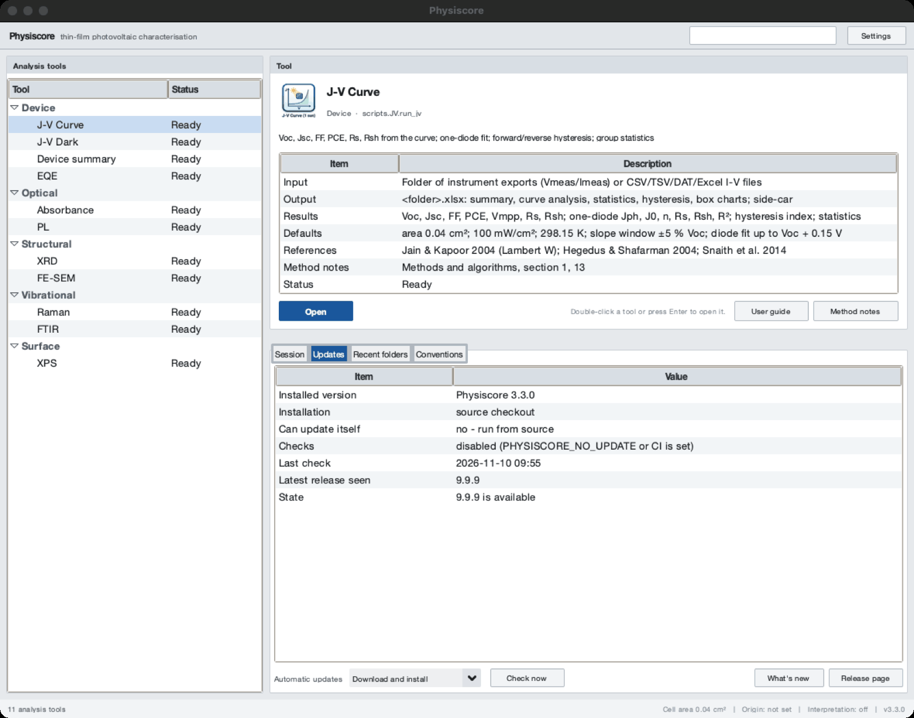
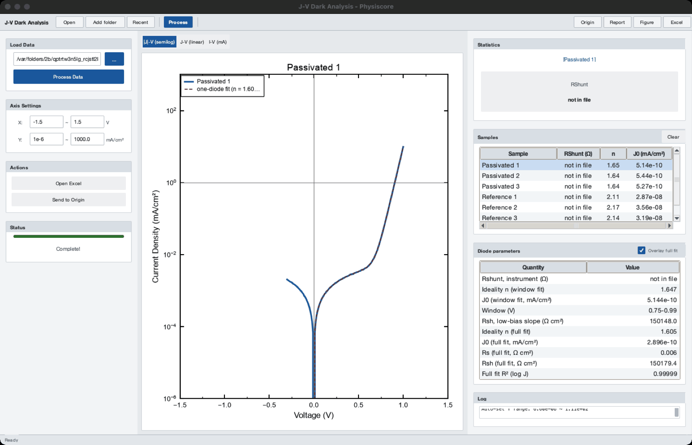
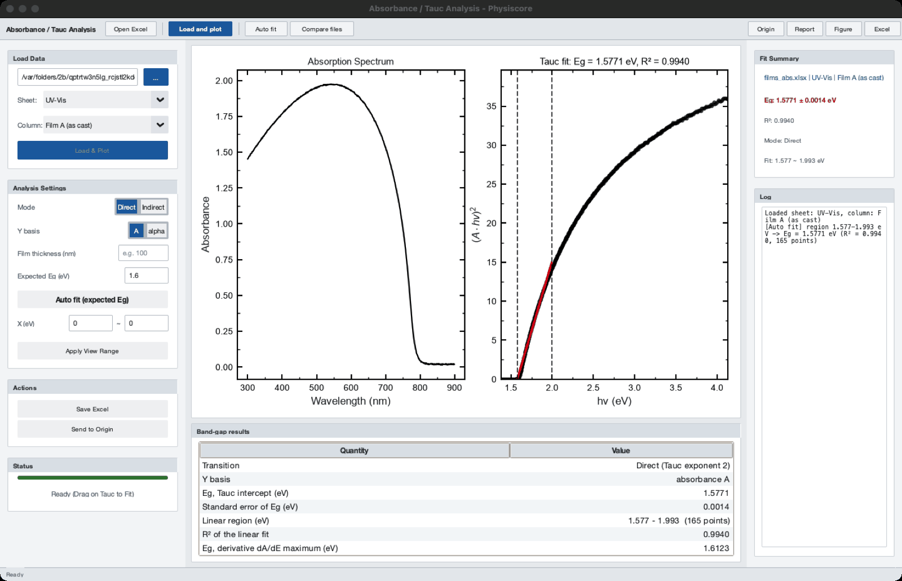
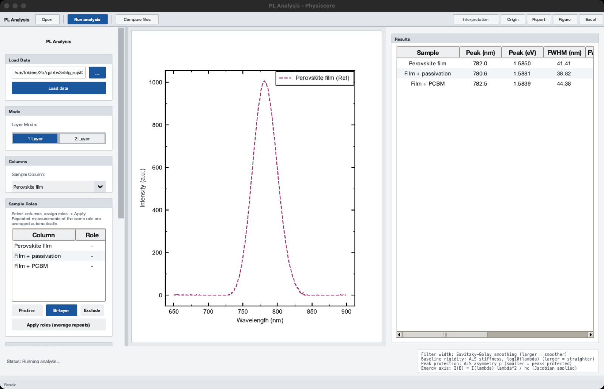
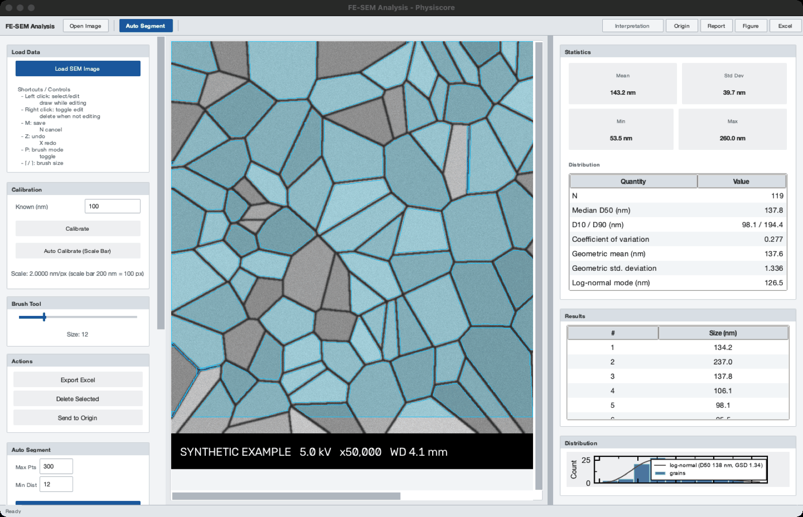
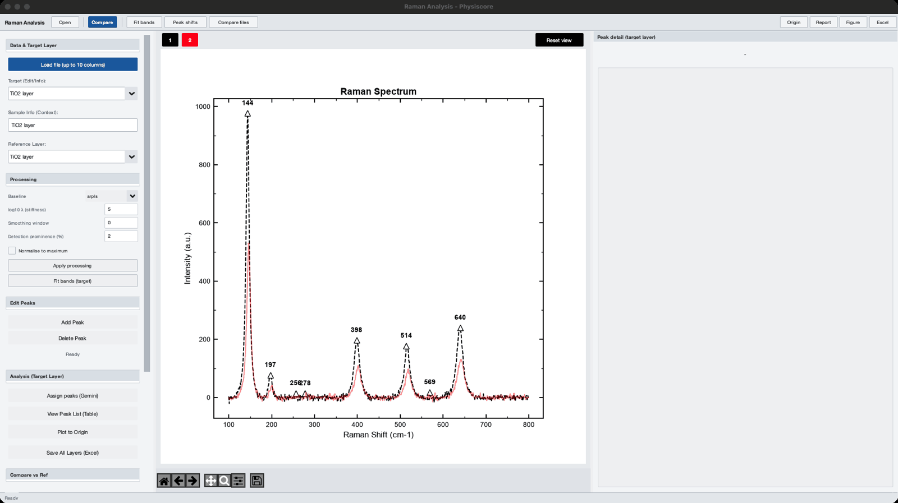
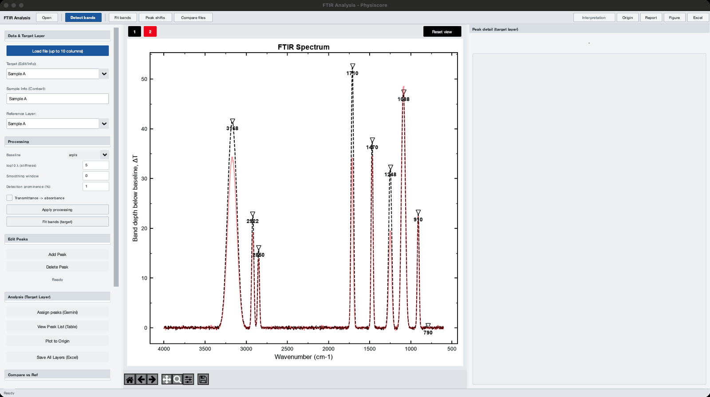
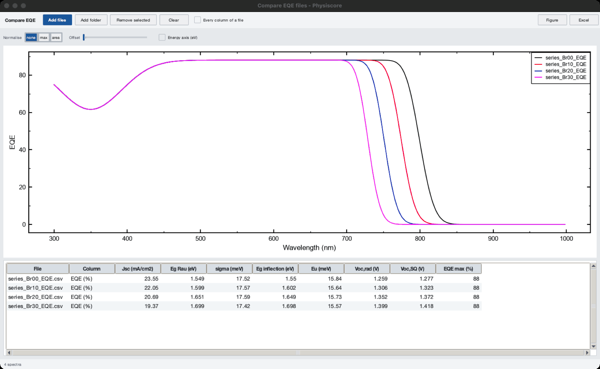

# Physiscore user guide

This guide walks through every window of Physiscore 3.1: what to load, what each
control does, what is computed and where the results go. The equations behind the
numbers are in [METHODS.md](METHODS.md); the accepted file layouts in
[FILE_FORMATS.md](FILE_FORMATS.md); the command line in [CLI.md](CLI.md).

Contents

1. [Starting the program](#1-starting-the-program)
2. [Things every window shares](#2-things-every-window-shares)
3. [J-V Curve](#3-j-v-curve)
4. [J-V Dark](#4-j-v-dark)
5. [Device summary](#5-device-summary)
6. [EQE](#6-eqe)
7. [Absorbance](#7-absorbance)
8. [PL](#8-pl)
9. [XRD](#9-xrd)
10. [FE-SEM](#10-fe-sem)
11. [Raman and FTIR](#11-raman-and-ftir)
12. [XPS and the auto-fit workspaces](#12-xps-and-the-auto-fit-workspaces)
13. [Comparing many files](#13-comparing-many-files)
14. [Outputs, reports and side-car files](#14-outputs-reports-and-side-car-files)
15. [Settings](#15-settings)
16. [Troubleshooting](#16-troubleshooting)

---

## 1. Starting the program

*The main window: tool tree on the left; the selected tool with its input, output and method notes, the session settings, recent folders and the conventions on the right.*

| How | Command |
|---|---|
| Installed copy | Start **Physiscore** from the Start menu, Launchpad/Applications, or the Linux menu |
| From source | `python Physiscore_Launcher.py` |
| One tool directly | `Physiscore --tool "J-V Curve"` (or `python Physiscore_Launcher.py --tool "XRD"`) |
| An auto-fit workspace | `Physiscore --spectra XRD` / `PL` / `XPS` |

The main window is a workbench (3.2):

- **Analysis tools** (left): the eleven tools grouped by category (Device, Optical,
  Structural, Vibrational, Surface) with their status - *Ready* once the tool's code has
  loaded in the background, *External program* for an external J-V executable on
  Windows, *Unavailable* if a module failed to import. The filter field in the toolbar
  narrows the list. Double-click a tool or press Enter to open it.
- **Tool**: what the selected tool derives, the files it reads (*Input*), the files it
  writes (*Output*), the quantities it reports (*Results*), its default settings
  (*Defaults*), the papers its methods follow (*References*) and the section of the method
  notes that documents it; buttons *Open*, *Auto-fit workspace* (PL, XRD), *User guide*
  and *Method notes* (opens the offline methods document at that section).
- Tabs below the tool panel:
  - **Session**: the device area used for current densities, the irradiance and
    temperature defaults, the Origin path, whether the optional interpretation is on, the
    settings file and the version.
  - **Updates**: the installed version, how this copy was installed and whether it can
    update itself, the automatic-update setting, the last check, the latest release seen
    and the state, with *Check now*, *Install now and restart*, *What's new* and *Release
    page* (details in the installation guide).
  - **Recent folders**: folders processed in J-V Curve and J-V Dark; double-click opens
    the tool with the folder filled in.
  - **Conventions**: units, sign conventions and the plot style.

*The Updates tab of a copy run from source (it cannot update itself; automatic checks are
switched off by `PHYSISCORE_NO_UPDATE`).*

The status bar repeats the device area, the Origin and interpretation state and the
version.

Menus of the main window:

- **File** - Settings (Ctrl+,), open the settings folder, Quit (Ctrl+Q).
- **Analysis** - every tool and the three auto-fit workspaces.
- **Tools** - Updates (check now; download and install / only notify / off), Run
  self-test (imports every module and checks reference physics), command-line help.
- **Help** - the offline documentation: user guide (**F1**), methods and algorithms,
  validation, file formats, command line, installation and updates, *What's new* in this
  version; the documentation on the web, the issue tracker, About.

## 2. Things every window shares

**Menu bar.** *File* (open actions, Close window Ctrl+Q), *Analysis* (run, fit and
extra actions), *Export* (Excel, Save figure Ctrl+S, Copy figure to clipboard, Report,
Origin), *View* (Auto range, Toggle legend, Toggle grid), *Help* (mouse and keyboard,
methods, About).

**Toolbar.** Open actions on the left, then the run action (the only solid blue button,
also F5), then fit and extra actions, in groups separated by thin rules. Exports on the
right: Excel (Ctrl+E), Figure, Report, Origin, Interpretation.

**Panels.** Every group of controls or results sits in a box with a grey title strip
(as in the dock panels of instrument software); tables have alternating row shading and
right-aligned numbers.

**Status bar.** Status text on the left; on the right the data coordinates under the
mouse pointer (x, y of the plot), useful for reading off a peak position or a voltage.

**Plots.** Every graph is drawn the way Origin draws it: white page, black 1.5 pt axis
box, ticks pointing in on all four sides with one minor tick between majors, no grid,
Arial, square black-framed legend, series colours in Origin's order (black, red, blue,
magenta, olive, navy ...; *Settings → Plot colours → Colour-blind safe* for Okabe-Ito
colours). Mouse wheel zooms around the pointer (Ctrl = x only, Shift = y only); left
drag pans where dragging is not used for range selection; double-click restores the full
range; right-click opens Auto range / Toggle legend / Toggle grid / Save figure.

**Tables.** Right-click copies selected rows or the whole table (tab-separated, pastes
into Excel/Origin); Ctrl+C copies the selection. In J-V and dark J-V, F2 renames a
sample or condition (see 3.4).

**Figure export.** *Figure* saves a publication-style copy of the current plot: white
background, black axes and text, inward ticks on all four sides, no grid; PNG or TIFF at
600 dpi, or SVG/PDF vector. The on-screen figure is not changed.

**Report.** A Markdown file with every result table of the tool, a 300 dpi figure next
to it, the input paths, the program version and date, and a methods note. Open it in any
Markdown viewer, paste it into a lab notebook, or convert it with pandoc.

## 3. J-V Curve

*Eight example cells in two conditions. Left: folder and axis range. Centre: the selected device with its one-diode fit. Right: statistics of the selection, the best device per condition and the device analysis. Synthetic example data.*

Illuminated current-voltage curves of many cells, grouped by condition.

### 3.1 Loading

1. **Open** - choose the folder that holds the measurement files. Every `.txt`
   instrument export and every CSV/TSV/DAT/XLSX curve in the folder is read (workbooks
   that Physiscore wrote itself are skipped).
2. **Add folder** - overlay another folder for a direct comparison in the same run;
   a sample name that occurs in both folders gets a ` (2)` suffix instead of being
   averaged.
3. **Recent** - the last eight folders; choosing one processes it immediately.
4. **Process** (F5) - parses, analyses and writes `<folder name>.xlsx` into the folder.

Grouping: a file name `Ref 3.txt` is cell 3 of condition `Ref`. The instrument's export
timestamp and a leading sequence number (`01. `) are removed from names; `110C` is shown
as `110°C`; underscores become spaces.

### 3.2 What is computed

- From the instrument summary block (when present): Voc, Jsc, FF, PCE per cell.
- From the curve, for every cell: Voc, Jsc, FF, PCE, Vmpp, Jmpp, Pmax, Rs (slope at
  Voc), Rsh (slope at Jsc). A file without a summary block gets its summary from these
  curve values (column *Summary source* = `curve`), so it still enters the statistics.
- One-diode fit for every cell with a photovoltaic response: Jph, J0, n, Rs, Rsh and
  the fit R² (about 20 ms per cell).
- Forward/reverse sweeps: a file that was swept both ways is split, analysed per
  direction, and the hysteresis index HI = (PCE_rev - PCE_fwd)/PCE_rev is reported.
- Per condition: mean, sample standard deviation and best value of Voc, Jsc, FF, PCE
  over all cells, and N; box charts of the four parameters.

### 3.3 The window

- **Plot** - *J-V Curve* shows the best cell of every condition (or the selected ones);
  *Box Plot* shows the distribution of the parameter chosen in the Statistics panel.
  The axis fields under *Axis Settings* set the J-V view range.
- **Statistics** (right) - without a selection: mean ± std of Voc, Jsc, FF over all
  cells and the best PCE. With one condition selected: that condition's best cell. With
  several selected: their averages. Clicking Voc/Jsc/FF/PCE switches to its box plot.
- **Best device per condition** - one row per condition; select one or more rows to
  plot them.
- **Device analysis** - for the selected condition: the best cell's curve parameters,
  the one-diode fit (n, J0, Rs, Rsh, R²) and, if both sweep directions were measured,
  PCE forward/reverse and the hysteresis index. *Overlay diode fit* draws the fitted
  curve over the data.

### 3.4 Naming

Right-click a row of the table: Rename (F2), Rename to preset, Compose name from presets
(e.g. `ZnO / PDINN`), Add current name to presets, Edit presets, Batch rename (find /
replace with live preview and duplicate check; *Strip common prefix*), Revert to
original name, Copy. A rename updates the plot, box charts and statistics. Presets are
shared by all tools.

### 3.5 Outputs

`<folder>.xlsx` (written on Process): CombinedData (every curve), SummaryTable (best
cells highlighted), BestPerformance, BestCombinedData, CurveAnalysis (curve parameters
and diode fit), Statistics, Hysteresis (when present), Voc/Jsc/Fill/PCE_BoxChart;
`<folder>.analysis.json` next to it. Origin J-V / Origin Box send the selected data to
OriginPro (Windows, Origin path in Settings).

## 4. J-V Dark

*|J| on a log axis with the full one-diode fit (dashed). Files without the instrument summary block show the shunt resistance as *not in file*. Synthetic example data.*

Dark current-voltage curves, plotted as |J| on a log axis (or J linear, or I in mA).

- **Open / Add folder / Recent / Process** as in J-V; writes `<folder>_Dark.xlsx`.
- Table columns: instrument Rshunt, ideality n and J0 from the sliding-window fit.
- **Diode parameters** panel for the selected sample: window fit (n, J0, window, Rsh
  from the low-bias slope), full one-diode fit with series resistance (n, J0, Rs, Rsh,
  R² in log space) and the Cheung analysis (Rs and n from dV/dlnJ). *Overlay full fit*
  draws the fitted curve.

When to trust which value: the window fit is model-light and robust; the full fit is the
value of record when the curve bends over at high bias (series resistance); the Cheung
values are an independent check of Rs.

## 5. Device summary

*One device: J-V with the fit and the maximum-power point, EQE with the integrated Jsc, the band gap from three techniques and the voltage-loss ladder Eg/q, Voc,SQ, Voc,rad, Voc. Synthetic example data.*

Joins the J-V, EQE, absorbance and PL of one device and checks them against each other.

1. Choose the **J-V curve** (instrument `.txt`, CSV or Excel) and select the **Sweep**
   (combined, forward or reverse; reverse by default).
2. Choose the **EQE spectrum** of the same device.
3. Optionally choose an **absorbance** file of the absorber film (with the Tauc
   transition) and a **PL** spectrum.
4. Check the **Conditions**: device area, irradiance, temperature and the two warning
   thresholds. Press **Compute**.

The summary table lists each quantity with its unit and the technique it came from:

| Group | Quantities |
|---|---|
| J-V | Voc, Jsc, FF, PCE, Rs, Rsh; one-diode n, J0, Rs, Rsh |
| Jsc check | Jsc from the EQE integral and the mismatch (Jsc,JV - Jsc,EQE)/Jsc,EQE |
| Band gap | from dEQE/dE (with edge width), from the Tauc plot, from the PL peak; their spread; the Stokes shift |
| Detailed balance | Urbach energy, J0,rad, Voc,rad; SQ limits (Jsc, Voc, FF, PCE) for the reference gap; Jsc/FF/PCE as fractions of the SQ values |
| Voltage loss | Voc deficit Eg/q - Voc split into ΔV1 (SQ), ΔV2 (radiative, from the sub-gap tail) and ΔV3 (non-radiative); the implied EQE_EL |

The four plots show the J-V curve with the diode fit and the maximum power point, the EQE
with the integrated Jsc (dotted line: Jsc from J-V), the band-gap values side by side and
the voltage ladder Eg/q → Voc,SQ → Voc,rad → Voc.

**Checks** lists warnings, for example a Jsc mismatch above 5 % (spectral mismatch, wrong
area, lamp intensity), a band-gap spread above 60 meV, or a Voc above the SQ limit (wrong
gap or temperature), and how each input was read.

Exports: Excel (Summary, AllValues, Checks, Inputs), Report, Figure, side-car.

## 6. EQE

*EQE against wavelength and energy, ln EQE with the Urbach window, dEQE/dE with the Rau band gap; below, the detailed-balance table for a measured Voc of 1.12 V. Synthetic example data.*

1. **Open file** - Excel (choose the sheet) or CSV; column 1 wavelength in nm, column 2
   EQE in % or as a fraction (detected automatically).
2. **Load and plot** - four plots: EQE with the cumulative AM1.5G-integrated Jsc on the
   right axis; ln(EQE) vs energy; EQE vs energy; the derivative dEQE/dE.
3. **Auto fit** - selects the absorption-edge window from the half-maximum of dEQE/dE
   and the Urbach window (EQE between 1 % and 30 % of its maximum below the edge).
   Dragging on *ln(EQE)* fits the Urbach energy over your own range; dragging on
   *EQE vs Energy* computes the derivative band gap over that range.
4. **Band gap, Urbach tail and detailed balance** table (bottom): Jsc, band gap from the
   derivative distribution (Rau) with its edge width, inflection-point gap, Urbach
   energy and window, J0,rad, Voc,rad, the SQ limits; with a **Measured Voc** entered,
   the ΔV1/ΔV2/ΔV3 breakdown and EQE_EL. **T (K)** sets the temperature of the
   detailed-balance calculation; **Recompute** applies the inputs.

Outputs: `<file>_result.xlsx` (Result, EQE_Data with AM1.5G and the integrand,
Urbach_Data, DetailedBalance) and its side-car; Report; Origin.

## 7. Absorbance

*Absorbance spectrum and Tauc plot with the automatically chosen linear region (dashed lines) and its fit. Synthetic example data.*

1. **Open Excel** - choose the sheet and, if the sheet holds several samples, the
   **Column**. Column 1 must be the wavelength in nm.
2. **Load and plot** - absorption spectrum and Tauc plot.
3. Choose **Direct** or **Indirect** (Tauc exponent 2 or 1/2). *Y basis* A or alpha:
   with a film thickness, α = 2.303·A/d is used; the band gap does not change, only the
   y scale.
4. **Auto fit** - selects the linear part of the edge automatically (see METHODS §4);
   *Expected Eg* (optional) restricts the search to ±0.6 eV around it. Or drag across
   the Tauc plot to fit your own range.

The **Band-gap results** table gives the Tauc band gap with its standard error, the
region and number of points, R², the derivative band gap (maximum of dA/dE) and the
Urbach energy below the edge. Outputs: `<file>_result.xlsx` (Result, UV-Vis, Tauc_Data)
and side-car; Report; Origin.

## 8. PL

*Three example films with the reference film plotted; the table lists peak position, FWHM, area and the quenching efficiency against the reference. Synthetic example data.*

1. **Open** - Excel or CSV with one wavelength column and one or more sample columns
   (the sheet whose name contains "pl" is chosen automatically).
2. *Mode* 1 Layer or 2 Layer, and *Sample* / *Reference* columns. **Sample Roles**:
   select columns, mark them *Pristine*, *Bi-layer* or *Exclude* and press *Apply
   Roles* - repeated measurements of one role are averaged and the averages become the
   reference (Pristine) and the sample (Bi-layer).
3. **Parameters** (live preview): *Filter width* (Savitzky-Golay window), *Baseline
   rigidity* (log10 λ of the ALS baseline; the stiffness needed grows with the number of
   points under a band - for a ~40 nm wide band sampled every 0.5 nm use 8, a value of 6
   lets the baseline bend under the band and narrows the FWHM by ~10 %), *Peak
   protection* (ALS asymmetry), *X axis*
   (wavelength, or energy with the Jacobian applied), *Peak model* (single Gaussian, or
   up to three Gaussian / Voigt components chosen by AICc).
4. **Run analysis** - for every column: peak position (nm and eV), FWHM (nm and meV),
   integrated intensity, maximum, quenching efficiency against the reference by peak
   height and by area, and the number of components. Fit components are drawn dotted.

Outputs: Excel (PL_Results, Processed spectra) with side-car; Report; Origin; Compare files.

## 9. XRD

*Fitted pattern with the reference peak list drawn as hkl ticks; the peak at 12.7° has no reference line (a second phase). Synthetic example data.*

1. **Open** - a two-column pattern (2θ in degrees, intensity); text, CSV or Excel. A
   metadata header is skipped.
2. Options (left): **Instrument FWHM** (°, removed in quadrature from every width; use a
   standard such as LaB6 or Si), **Scherrer K** (0.9 by default), **Strip Cu Kα2**
   (Rachinger), **Reference tolerance** (° for matching a reference list).
3. **Run fitting** - ALS background, simultaneous pseudo-Voigt fit of overlapping
   reflections. The peak table lists 2θ, intensity, d, FWHM, Scherrer size τ, the
   pseudo-Voigt mixing η and the fit R². Clicking a row zooms to that reflection. The
   crystallinity index (area above the ALS background / total area) is shown under the
   options.
4. **W-H plot** - Williamson-Hall analysis of all reflections: crystallite size D and
   microstrain ε with their standard errors.
5. **Lattice parameter** - enter h k l for the reflections you can index; returns a
   cubic lattice parameter (mean ± std and the Nelson-Riley extrapolation).
6. **Reference** - load a reference peak list (CSV/TXT/XLSX with 2θ or d, optional hkl
   and relative intensity; see FILE_FORMATS). The reference lines are drawn as ticks with
   their hkl; a table lists every matched reflection with its shift and strain
   (d - d0)/d0, the coverage (fraction of the reference lines found) and the observed
   peaks that belong to no reference line (another phase, e.g. PbI2 in a perovskite).
   The match is repeated after every new fitting run.
7. *Fit range* (button under the plot) - when on, dragging fits only the selected 2θ
   range and replaces the peaks in it.

Outputs: Excel (Peaks, Pattern with the fit, WilliamsonHall, ReferenceMatch,
Crystallinity) with side-car; Report; Origin; Compare files (stacked patterns).

## 10. FE-SEM

*Automatic segmentation of a synthetic grain image (outlined grains), statistics and the size list. Synthetic example data.*

1. **Open Image** (TIF/PNG/JPG/BMP).
2. **Calibrate** - drag along the scale bar and enter its length in nm, or *Auto
   Calibrate (Scale Bar)*.
3. Click a grain to segment it (watershed in a region around the click; flood fill as a
   fallback); the brush adds or removes pixels; **Auto Segment** seeds the whole image
   automatically (*Max Pts*, *Min Dist*). The status bar footer (instrument data bar) is
   excluded.
4. The **Statistics** panel shows mean, standard deviation, min, max and the
   **Distribution** table: N, D50, D10/D90, coefficient of variation, geometric mean,
   geometric standard deviation, log-normal mode. The histogram carries the fitted
   log-normal curve.

Outputs: Excel (Grains, Statistics) with side-car; Report; Origin histogram with a
log-normal fit.

## 11. Raman and FTIR

*Two layers overlaid after the arPLS baseline, with the detected bands of the target layer. Synthetic example data.*

*FTIR in transmittance: bands are shown as their depth below the baseline (ΔT); tick *Transmittance -> absorbance* to work in absorbance.*

1. **Open** - one wavenumber column and up to ten spectrum columns; each column becomes a
   *layer* named after its header.
2. **Processing**: baseline (arPLS by default; ALS, end-point line, minimum or none),
   log10 λ, smoothing window, detection prominence (% of the range), and for FTIR
   *Transmittance -> absorbance*. **Apply processing** re-runs every layer.
3. Choose the **Target** and **Reference** layers; keys 1-9 show one layer; Left/Right
   step through the bands of the target. *Add Peak* / *Delete Peak* edit the band list
   (Enter confirms an added band).
4. **Fit bands** - Lorentzian (Raman) or Gaussian (FTIR) fit of the target's bands,
   overlapping bands together; table with centre, FWHM, area, uncertainties and R²; the
   fitted envelope is drawn dotted.
5. **Peak shifts** - every layer against the reference: matched bands with their shift,
   bands present in only one of them.
6. Clicking a band shows its fit and indicative assignments from the built-in band
   library (70 typical positions for PV materials; confirm against the literature).
7. Optional **Interpretation** (Gemini) assigns the target's peaks or compares two
   selected peaks; it needs an API key and never changes the numbers.

Outputs: Excel, Report (band tables, library suggestions, shift table), Origin, Compare files.

## 12. XPS and the auto-fit workspaces

*Pb 4f region with a metallic shoulder: Shirley baseline (top) and the four fitted components on the corrected spectrum (bottom); the binding energy decreases to the right. Synthetic example data.*

**Auto-fit workspace** (PL, XRD, XPS) - a parameter-driven pipeline: Savitzky-Golay
smoothing, background, noise-adaptive peak detection and Voigt fitting; *Before / After*
shows the processing steps; *Batch Folder* runs the same parameters over every file of a
folder and writes `summary.xlsx`; *Peak report* writes a Markdown report.

XPS block: **Background** (Shirley by default, or AsLS), **Charge shift** (eV added to
every binding energy, e.g. 284.8 minus the measured C 1s), **Doublet split** and **area
ratio** (0 for s levels; typical values are listed in the panel), **Region of interest**.
**Quantify (atomic %)** assigns each fitted peak to a core level and computes atomic
concentrations with Scofield factors (or the factors of your instrument).

## 13. Comparing many files

*Four EQE spectra of a composition series analysed side by side. Synthetic example data.*

**Compare files** (EQE, Absorbance, PL, XRD, Raman, FTIR) opens a window in which you
add files or a whole folder (optionally every column of each file). Each spectrum is
analysed with the same function as the batch command, the results are tabulated side by
side and the spectra overlaid; *Normalise* (none / max / area) and *Offset* make stacked
figures; *Energy axis* converts EQE, absorbance and PL to eV. Excel exports the table and
every spectrum (one sheet each) with a side-car.

The command `physiscore_cli.py batch` does the same without the GUI (see CLI.md).

## 14. Outputs, reports and side-car files

Every Excel export is accompanied by `<name>.analysis.json`, a side-car that records the
program version, date and time, Python and platform, the input files, every analysis
parameter (area, thresholds, windows, models, references) and the main results. It lets
a number in a manuscript be traced to the exact analysis and lets scripts re-run or
compare analyses. Files with a side-car are recognised as outputs and are never read back
as inputs.

## 15. Settings

**File → Settings** in the main window:

| Setting | Effect |
|---|---|
| Device active area (cm²) | current density = current / area; scales Jsc and PCE linearly; read again for every analysis |
| OriginLab executable | enables the Origin buttons (Windows) |
| Gemini API key | enables the optional *Interpretation* panels only; no number depends on it |
| Appearance | Light (default) or Dark; applies after a restart (graphs stay white, as in Origin) |
| Plot colours | Origin (default: black, red, blue, magenta, olive, navy ...) or Colour-blind safe (Okabe-Ito); applies after a restart |

Settings live in `physisfera_config.json` (installed copies: the per-user folder,
**File → Open settings folder**). `PHYSISCORE_CONFIG` points to another file;
`PHYSISCORE_THEME=dark` overrides the appearance for one run; `PHYSISCORE_NO_UPDATE=1`
disables the update check.

## 16. Troubleshooting

| Symptom | What to check |
|---|---|
| A J-V folder gives "No valid data found" | the files need a `Vmeas / Imeas` block, or a CSV/Excel layout with voltage and current columns (FILE_FORMATS §1) |
| PCE values are off by a constant factor | the device area in Settings |
| The Jsc mismatch in Device summary is large | spectral mismatch factor of the simulator, lamp calibration, area, or EQE measured on a different cell |
| The EQE band gap looks wrong | EQE must be in % or as a fraction against wavelength in nm, ascending or descending |
| Auto fit finds no Tauc region | choose Direct/Indirect correctly, enter an expected gap, or drag the range by hand |
| XRD peaks are missing | lower the noise level of the pattern or use *Fit range* on the region; check that 2θ is in degrees |
| The Origin buttons do nothing | Windows only; set the Origin path in Settings; Origin must be installed with its automation server |
| macOS refuses to open the app | System Settings → Privacy & Security → Open Anyway (INSTALL.md) |
| Results differ from an older version | check the side-car of both exports: the parameters (area, windows, models) are listed there |

Bugs and requests: <https://github.com/jongsu-king/physiscore/issues> (please attach
the side-car and, if you can, a data file).
