# Physiscore user guide

This guide walks through every window of Physiscore 3.5: what to load, what each
control does, what is computed and where the results go. The equations behind the
numbers are in [METHODS.md](METHODS.md); the accepted file layouts in
[FILE_FORMATS.md](FILE_FORMATS.md); the command line in [CLI.md](CLI.md).

Contents

1. [Starting the program](#1-starting-the-program)
2. [Things every window shares](#2-things-every-window-shares)
3. [J-V Curve](#3-j-v-curve)
4. [J-V Dark](#4-j-v-dark)
5. [Device summary](#5-device-summary)
6. [EQE](#6-eqe)
7. [Absorbance](#7-absorbance)
8. [PL](#8-pl)
9. [XRD](#9-xrd)
10. [FE-SEM](#10-fe-sem)
11. [Raman and FTIR](#11-raman-and-ftir)
12. [XPS and the auto-fit workspaces](#12-xps-and-the-auto-fit-workspaces)
13. [Transport and recombination tools](#13-transport-and-recombination-tools): SCLC,
    light intensity, TRPL, impedance, C-V, stability
14. [Workspace folder and results index](#14-workspace-folder-and-results-index)
15. [Comparing many files](#15-comparing-many-files)
16. [Outputs, reports and side-car files](#16-outputs-reports-and-side-car-files)
17. [Settings](#17-settings)
18. [Interpretation](#18-interpretation)
19. [Troubleshooting](#19-troubleshooting)

---

## 1. Starting the program

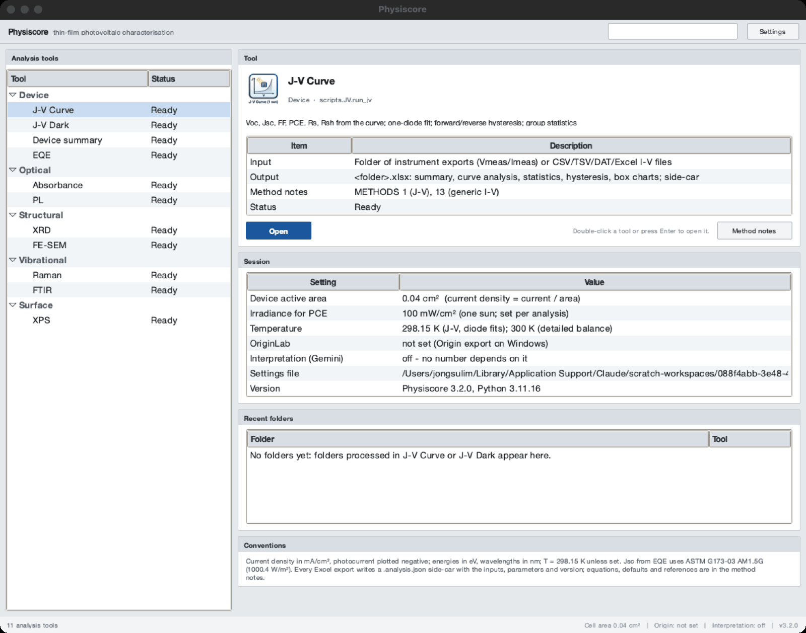

*The main window: tool tree on the left; on the right the selected tool with its input, output and method notes, and below it the tabs - here the Workspace tab with the measurements of a project folder. Synthetic example data.*

| How | Command |
|---|---|
| Installed copy | Start **Physiscore** from the Start menu, Launchpad/Applications, or the Linux menu |
| From source | `python Physiscore_Launcher.py` |
| One tool directly | `Physiscore --tool "J-V Curve"` (or `python Physiscore_Launcher.py --tool "XRD"`) |
| An auto-fit workspace | `Physiscore --spectra XRD` / `PL` / `XPS` |
| Data files | `Physiscore --open FILE ...` - the measurement is recognised and its tool opens (section 14.2) |
| A project folder | `Physiscore --open FOLDER` - the main window with that folder as the workspace |

The main window is a workbench:

- **Toolbar**: **Open data...** (Ctrl+O) picks one or more data files and opens them in
  the tool their content points to; **Workspace folder...** (Ctrl+Shift+O) lists every
  measurement of a folder in the Workspace tab (section 14).
- **Analysis tools** (left): the seventeen tools grouped by category (Device, Transport
  and recombination, Optical, Structural, Vibrational, Surface) with their status - *Ready* once the tool's code has
  loaded in the background, *External program* for an external J-V executable on
  Windows, *Unavailable* if a module failed to import. The filter field in the toolbar
  narrows the list. Double-click a tool or press Enter to open it.
- **Tool**: what the selected tool derives, the files it reads (*Input*), the files it
  writes (*Output*), the quantities it reports (*Results*), its default settings
  (*Defaults*), the papers its methods follow (*References*) and the section of the method
  notes that documents it; buttons *Open*, *Auto-fit workspace* (PL, XRD), *User guide*
  and *Method notes* (opens the offline methods document at that section).
- Tabs below the tool panel:
  - **Workspace**: the data files of the workspace folder, each with the measurement it
    holds, the confidence of that reading and the tool that opens it (section 14.1).
  - **Results**: every analysis exported below the workspace folder with its key numbers;
    *Collect to Excel* gathers them in one workbook (section 14.3).
  - **Session**: the workspace folder, the device area used for current densities, the
    irradiance and temperature defaults, the Origin path, how interpretation works
    (rule-based, offline), the settings file and the version.
  - **Updates**: the installed version, how this copy was installed and whether it can
    update itself, the automatic-update setting, the last check, the latest release seen
    and the state, with *Check now*, *Install now and restart*, *What's new* and *Release
    page* (details in the installation guide).
  - **Recent folders**: folders processed in J-V Curve and J-V Dark; double-click opens
    the tool with the folder filled in.
  - **Conventions**: units, sign conventions and the plot style.

*The Updates tab of a copy run from source (it cannot update itself; automatic checks are
switched off by `PHYSISCORE_NO_UPDATE`).*

The status bar repeats the device area, the Origin state and the version.

Menus of the main window:

- **File** - Open data (Ctrl+O), Open workspace folder (Ctrl+Shift+O), Collect results to
  Excel, Settings (Ctrl+,), open the settings folder, Quit (Ctrl+Q).
- **Analysis** - every tool and the three auto-fit workspaces.
- **Tools** - Updates (check now; download and install / only notify / off), Run
  self-test (imports every module and checks reference physics), command-line help.
- **Help** - the offline documentation: user guide (**F1**), methods and algorithms,
  validation, file formats, command line, installation and updates, *What's new* in this
  version; the documentation on the web, the issue tracker, About.

## 2. Things every window shares

**Menu bar.** *File* (open actions, Close window Ctrl+Q), *Analysis* (run, fit and
extra actions), *Export* (Excel, Save figure Ctrl+S, Export figure with a journal preset
Ctrl+Shift+S, Copy figure to clipboard, Data worksheet Ctrl+D, Report, Origin), *View*
(Auto range, Toggle legend, Toggle grid, Data reader Ctrl+R, Plot details Ctrl+P), *Help*
(Mouse and keyboard, **Methods of this tool** - the offline method notes at the section
of the tool - Methods online, About).

**Toolbar.** Open actions on the left, then the run action (the only solid blue button,
also F5), then fit and extra actions, in groups separated by thin rules. Exports on the
right: Excel (Ctrl+E), Figure, Report, Origin, Interpretation.

**Panels.** Every group of controls or results sits in a box with a grey title strip
(as in the dock panels of instrument software); tables have alternating row shading and
right-aligned numbers.

**Status bar.** Status text on the left; on the right the data coordinates under the
mouse pointer (x, y of the plot), useful for reading off a peak position or a voltage.

**Plots.** Every graph is drawn the way Origin draws it: white page, black 1.5 pt axis
box, ticks pointing in on all four sides with one minor tick between majors, no grid,
Arial, square black-framed legend, series colours in Origin's order (black, red, blue,
magenta, olive, navy ...; *Settings → Plot colours → Colour-blind safe* for Okabe-Ito
colours). Mouse wheel zooms around the pointer (Ctrl = x only, Shift = y only); left
drag pans where dragging is not used for range selection; double-click restores the full
range; right-click opens Auto range / Toggle legend / Toggle grid, the graph tools below
and the two figure exports.

**Graph tools** (3.5; *View* and *Export* menus, or right-click on the graph). They act
on the graph on screen and never change a result:

| Tool | Shortcut | What it does |
|---|---|---|
| Data reader | Ctrl+R | click a curve to read the nearest measured point (not an interpolated one); a second click gives Δx, Δy and the slope between the two points. Ctrl+R again switches it off |
| Plot details | Ctrl+P | axis titles, limits (an empty field = automatic) and linear/log scales; per curve the name, line width, line style, marker, colour and whether it is shown. *Apply* redraws; a new run of the analysis restores the standard style |
| Export figure (journal preset) | Ctrl+Shift+S | saves the figure at a stated physical size: single column 85 mm (8 pt), 1.5 column 114 mm (8 pt), double column 174 mm (9 pt), slide 16:9 254 mm (14 pt) or as displayed; width, height, font size and dpi can be edited; PNG, TIFF, PDF, SVG or EPS; optional transparent background |
| Data worksheet | Ctrl+D | the numbers behind every curve of the figure as a table: copy it into Origin or Excel, or save it as CSV |

The shortcuts do not fire while the cursor is in a text field.

**Tables.** Right-click copies selected rows or the whole table (tab-separated, pastes
into Excel/Origin); Ctrl+C copies the selection. In J-V and dark J-V, F2 renames a
sample or condition (see 3.4).

**Figure export.** *Figure* (Ctrl+S) saves a publication-style copy of the current plot:
white background, black axes and text, inward ticks on all four sides, no grid; PNG or
TIFF at 600 dpi, or SVG/PDF vector. The on-screen figure is not changed. For a figure of
a given column width and font size use *Export figure (journal preset)* above.

**Report.** A Markdown file with every result table of the tool, a 300 dpi figure next
to it, the input paths, the program version and date, and a methods note. Open it in any
Markdown viewer, paste it into a lab notebook, or convert it with pandoc.

## 3. J-V Curve

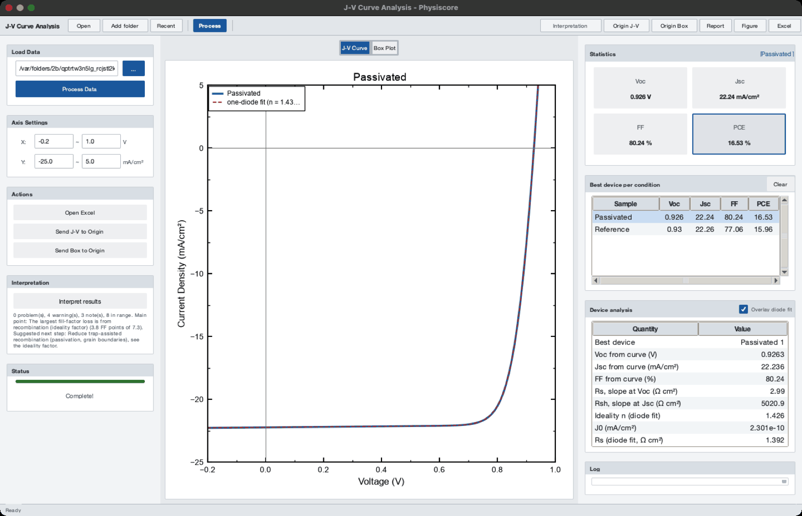

*Eight example cells in two conditions. Left: folder and axis range. Centre: the selected device with its one-diode fit. Right: statistics of the selection, the best device per condition and the device analysis. Synthetic example data.*

Illuminated current-voltage curves of many cells, grouped by condition.

### 3.1 Loading

1. **Open** - choose the folder that holds the measurement files. Every `.txt`
   instrument export and every CSV/TSV/DAT/XLSX curve in the folder is read (workbooks
   that Physiscore wrote itself are skipped).
2. **Add folder** - overlay another folder for a direct comparison in the same run;
   a sample name that occurs in both folders gets a ` (2)` suffix instead of being
   averaged.
3. **Recent** - the last eight folders; choosing one processes it immediately.
4. **Process** (F5) - parses, analyses and writes `<folder name>.xlsx` into the folder.

Grouping: a file name `Ref 3.txt` is cell 3 of condition `Ref`. The instrument's export
timestamp and a leading sequence number (`01. `) are removed from names; `110C` is shown
as `110°C`; underscores become spaces.

### 3.2 What is computed

- From the instrument summary block (when present): Voc, Jsc, FF, PCE per cell.
- From the curve, for every cell: Voc, Jsc, FF, PCE, Vmpp, Jmpp, Pmax, Rs (slope at
  Voc), Rsh (slope at Jsc). A file without a summary block gets its summary from these
  curve values (column *Summary source* = `curve`), so it still enters the statistics.
- One-diode fit for every cell with a photovoltaic response: Jph, J0, n, Rs, Rsh and
  the fit R² (about 20 ms per cell).
- Forward/reverse sweeps: a file that was swept both ways is split, analysed per
  direction, and the hysteresis index HI = (PCE_rev - PCE_fwd)/PCE_rev is reported.
- Per condition: mean, sample standard deviation and best value of Voc, Jsc, FF, PCE
  over all cells, and N; box charts of the four parameters.

### 3.3 The window

- **Plot** - *J-V Curve* shows the best cell of every condition (or the selected ones);
  *Box Plot* shows the distribution of the parameter chosen in the Statistics panel.
  The axis fields under *Axis Settings* set the J-V view range.
- **Statistics** (right) - without a selection: mean ± std of Voc, Jsc, FF over all
  cells and the best PCE. With one condition selected: that condition's best cell. With
  several selected: their averages. Clicking Voc/Jsc/FF/PCE switches to its box plot.
- **Best device per condition** - one row per condition; select one or more rows to
  plot them.
- **Device analysis** - for the selected condition: the best cell's curve parameters,
  the one-diode fit (n, J0, Rs, Rsh, R²) and, if both sweep directions were measured,
  PCE forward/reverse and the hysteresis index. *Overlay diode fit* draws the fitted
  curve over the data.

### 3.4 Naming

Right-click a row of the table: Rename (F2), Rename to preset, Compose name from presets
(e.g. `ZnO / PDINN`), Add current name to presets, Edit presets, Batch rename (find /
replace with live preview and duplicate check; *Strip common prefix*), Revert to
original name, Copy. A rename updates the plot, box charts and statistics. Presets are
shared by all tools.

### 3.5 Outputs

`<folder>.xlsx` (written on Process): CombinedData (every curve), SummaryTable (best
cells highlighted), BestPerformance, BestCombinedData, CurveAnalysis (curve parameters
and diode fit), Statistics, Hysteresis (when present), Voc/Jsc/Fill/PCE_BoxChart;
`<folder>.analysis.json` next to it. Origin J-V / Origin Box send the selected data to
OriginPro (Windows, Origin path in Settings).

## 4. J-V Dark

*|J| on a log axis with the full one-diode fit (dashed). Files without the instrument summary block show the shunt resistance as *not in file*. Synthetic example data.*

Dark current-voltage curves, plotted as |J| on a log axis (or J linear, or I in mA).

- **Open / Add folder / Recent / Process** as in J-V; writes `<folder>_Dark.xlsx`.
- Table columns: instrument Rshunt, ideality n and J0 from the sliding-window fit.
- **Diode parameters** panel for the selected sample: window fit (n, J0, window, Rsh
  from the low-bias slope), full one-diode fit with series resistance (n, J0, Rs, Rsh,
  R² in log space) and the Cheung analysis (Rs and n from dV/dlnJ). *Overlay full fit*
  draws the fitted curve.

When to trust which value: the window fit is model-light and robust; the full fit is the
value of record when the curve bends over at high bias (series resistance); the Cheung
values are an independent check of Rs.

## 5. Device summary

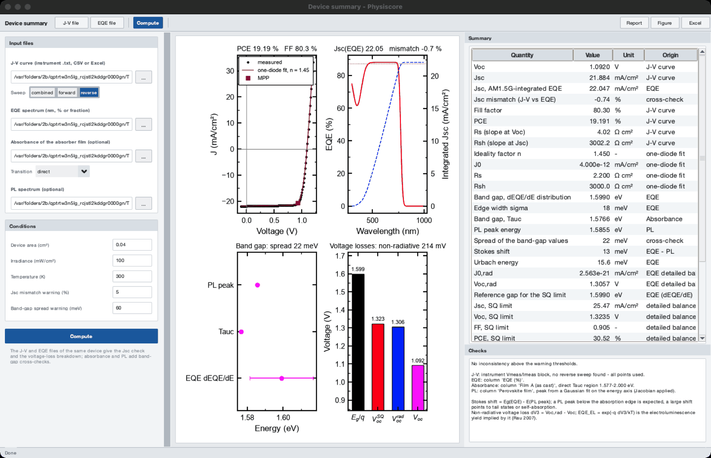

*One device: J-V with the fit and the maximum-power point, EQE with the integrated Jsc, the band gap from three techniques and the voltage-loss ladder Eg/q, Voc,SQ, Voc,rad, Voc. Synthetic example data.*

Joins the J-V, EQE, absorbance and PL of one device and checks them against each other.

1. Choose the **J-V curve** (instrument `.txt`, CSV or Excel) and select the **Sweep**
   (combined, forward or reverse; reverse by default).
2. Choose the **EQE spectrum** of the same device.
3. Optionally choose an **absorbance** file of the absorber film (with the Tauc
   transition) and a **PL** spectrum.
4. Check the **Conditions**: device area, irradiance, temperature and the two warning
   thresholds. Press **Compute**.

The summary table lists each quantity with its unit and the technique it came from:

| Group | Quantities |
|---|---|
| J-V | Voc, Jsc, FF, PCE, Rs, Rsh; one-diode n, J0, Rs, Rsh |
| Jsc check | Jsc from the EQE integral and the mismatch (Jsc,JV - Jsc,EQE)/Jsc,EQE |
| Band gap | from dEQE/dE (with edge width), from the Tauc plot, from the PL peak; their spread; the Stokes shift |
| Detailed balance | Urbach energy, J0,rad, Voc,rad; SQ limits (Jsc, Voc, FF, PCE) for the reference gap; Jsc/FF/PCE as fractions of the SQ values |
| Voltage loss | Voc deficit Eg/q - Voc split into ΔV1 (SQ), ΔV2 (radiative, from the sub-gap tail) and ΔV3 (non-radiative); the implied EQE_EL |

The four plots show the J-V curve with the diode fit and the maximum power point, the EQE
with the integrated Jsc (dotted line: Jsc from J-V), the band-gap values side by side and
the voltage ladder Eg/q → Voc,SQ → Voc,rad → Voc.

**Checks** lists warnings, for example a Jsc mismatch above 5 % (spectral mismatch, wrong
area, lamp intensity), a band-gap spread above 60 meV, or a Voc above the SQ limit (wrong
gap or temperature), and how each input was read.

Exports: Excel (Summary, AllValues, Checks, Inputs), Report, Figure, side-car.

## 6. EQE

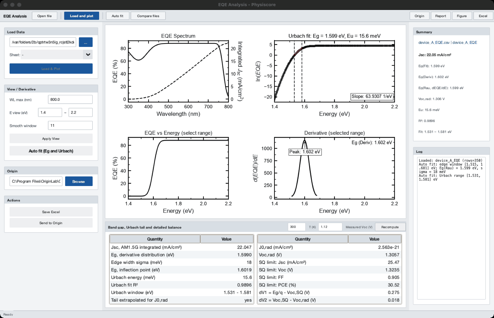

*EQE against wavelength and energy, ln EQE with the Urbach window, dEQE/dE with the Rau band gap; below, the detailed-balance table for a measured Voc of 1.12 V. Synthetic example data.*

1. **Open file** - Excel (choose the sheet) or CSV; column 1 wavelength in nm, column 2
   EQE in % or as a fraction (detected automatically).
2. **Load and plot** - four plots: EQE with the cumulative AM1.5G-integrated Jsc on the
   right axis; ln(EQE) vs energy; EQE vs energy; the derivative dEQE/dE.
3. **Auto fit** - selects the absorption-edge window from the half-maximum of dEQE/dE
   and the Urbach window (EQE between 1 % and 30 % of its maximum below the edge).
   Dragging on *ln(EQE)* fits the Urbach energy over your own range; dragging on
   *EQE vs Energy* computes the derivative band gap over that range.
4. **Band gap, Urbach tail and detailed balance** table (bottom): Jsc, band gap from the
   derivative distribution (Rau) with its edge width, inflection-point gap, Urbach
   energy and window, J0,rad, Voc,rad, the SQ limits; with a **Measured Voc** entered,
   the ΔV1/ΔV2/ΔV3 breakdown and EQE_EL. **T (K)** sets the temperature of the
   detailed-balance calculation; **Recompute** applies the inputs.

Outputs: `<file>_result.xlsx` (Result, EQE_Data with AM1.5G and the integrand,
Urbach_Data, DetailedBalance) and its side-car; Report; Origin.

## 7. Absorbance

*Absorbance spectrum and Tauc plot with the automatically chosen linear region (dashed lines) and its fit. Synthetic example data.*

1. **Open Excel** - choose the sheet and, if the sheet holds several samples, the
   **Column**. Column 1 must be the wavelength in nm.
2. **Load and plot** - absorption spectrum and Tauc plot.
3. Choose **Direct** or **Indirect** (Tauc exponent 2 or 1/2). *Y basis* A or alpha:
   with a film thickness, α = 2.303·A/d is used; the band gap does not change, only the
   y scale. *Sub-gap offset* Keep or Subtract: a constant absorbance below the gap
   (reflection, scattering, substrate) lowers the Tauc gap, by about 10 meV at 0.02 for a
   direct edge and 87 meV for an indirect one; Subtract removes the median absorbance of
   the lowest-energy 5 % of the spectrum (it must lie at least 0.15 eV below the edge;
   the log says when it does not). It does not correct interference fringes (3.5.3).
4. **Auto fit** - selects the linear part of the edge automatically (see METHODS §4);
   *Expected Eg* (optional) restricts the search to ±0.6 eV around it. Or drag across
   the Tauc plot to fit your own range.

The **Band-gap results** table gives the Tauc band gap with its standard error, the
region and number of points, R², the derivative band gap (maximum of dA/dE) and the
Urbach energy below the edge, and the sub-gap offset subtracted (if any). Outputs: `<file>_result.xlsx` (Result, UV-Vis, Tauc_Data)
and side-car; Report; Origin.

## 8. PL

*Three example films with the reference film plotted; the table lists peak position, FWHM, area and the quenching efficiency against the reference. Synthetic example data.*

1. **Open** - Excel or CSV with one wavelength column and one or more sample columns
   (the sheet whose name contains "pl" is chosen automatically).
2. *Mode* 1 Layer or 2 Layer, and *Sample* / *Reference* columns. **Sample Roles**:
   select columns, mark them *Pristine*, *Bi-layer* or *Exclude* and press *Apply
   Roles* - repeated measurements of one role are averaged and the averages become the
   reference (Pristine) and the sample (Bi-layer).
3. **Parameters** (live preview): *Filter width* (Savitzky-Golay window), *Baseline
   rigidity* (log10 λ of the ALS baseline; the stiffness needed grows with the number of
   points under a band - for a ~40 nm wide band sampled every 0.5 nm use 8, a value of 6
   lets the baseline bend under the band and narrows the FWHM by ~10 %), *Peak
   protection* (ALS asymmetry), *X axis*
   (wavelength, or energy with the Jacobian applied), *Peak model* (single Gaussian, or
   up to three Gaussian / Voigt components chosen by AICc).
4. **Run analysis** - for every column: peak position (nm and eV), FWHM (nm and meV),
   integrated intensity, maximum, quenching efficiency against the reference by peak
   height and by area, and the number of components. Fit components are drawn dotted.

Outputs: Excel (PL_Results, Processed spectra) with side-car; Report; Origin; Compare files.

## 9. XRD

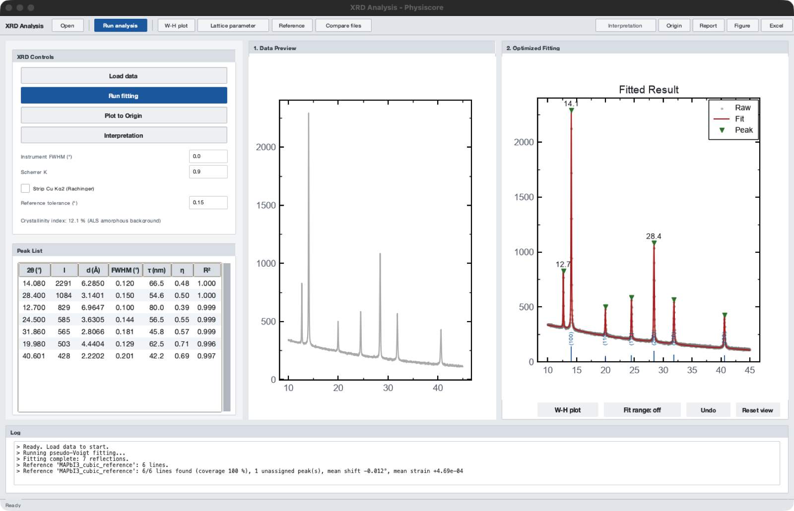

*Fitted pattern with the reference peak list drawn as hkl ticks; the peak at 12.7° has no reference line (a second phase). Synthetic example data.*

1. **Open** - a two-column pattern (2θ in degrees, intensity); text, CSV or Excel. A
   metadata header is skipped.
2. Options (left): **Instrument FWHM** (°, removed in quadrature from every width; use a
   standard such as LaB6 or Si), **Scherrer K** (0.9 by default), **Strip Cu Kα2**
   (Rachinger), **Reference tolerance** (° for matching a reference list).
3. **Run fitting** - ALS background, simultaneous pseudo-Voigt fit of overlapping
   reflections. The peak table lists 2θ, intensity, d, FWHM, Scherrer size τ, the
   pseudo-Voigt mixing η and the fit R². Clicking a row zooms to that reflection. The
   crystallinity index (area above the ALS background / total area) is shown under the
   options.
4. **W-H plot** - Williamson-Hall analysis of all reflections: crystallite size D and
   microstrain ε with their standard errors.
5. **Lattice parameter** - enter h k l for the reflections you can index; returns a
   cubic lattice parameter (mean ± std and the Nelson-Riley extrapolation).
6. **Reference** - load a reference peak list (CSV/TXT/XLSX with 2θ or d, optional hkl
   and relative intensity; see FILE_FORMATS). The reference lines are drawn as ticks with
   their hkl; a table lists every matched reflection with its shift and strain
   (d - d0)/d0, the coverage (fraction of the reference lines found) and the observed
   peaks that belong to no reference line (another phase, e.g. PbI2 in a perovskite).
   The match is repeated after every new fitting run.
7. *Fit range* (button under the plot) - when on, dragging fits only the selected 2θ
   range and replaces the peaks in it.

Outputs: Excel (Peaks, Pattern with the fit, WilliamsonHall, ReferenceMatch,
Crystallinity) with side-car; Report; Origin; Compare files (stacked patterns).

## 10. FE-SEM

*Automatic segmentation of a synthetic grain image (outlined grains), statistics and the size list. Synthetic example data.*

1. **Open Image** (TIF/PNG/JPG/BMP).
2. **Calibrate** - drag along the scale bar and enter its length in nm, or *Auto
   Calibrate (Scale Bar)*.
3. Click a grain to segment it (watershed in a region around the click; flood fill as a
   fallback); the brush adds or removes pixels; **Auto Segment** seeds the whole image
   automatically (*Max Pts*, *Min Dist*). The status bar footer (instrument data bar) is
   excluded.
4. The **Statistics** panel shows mean, standard deviation, min, max and the
   **Distribution** table: N, D50, D10/D90, coefficient of variation, geometric mean,
   geometric standard deviation, log-normal mode. The histogram carries the fitted
   log-normal curve.

Outputs: Excel (Grains, Statistics) with side-car; Report; Origin histogram with a
log-normal fit.

## 11. Raman and FTIR

*Two layers overlaid after the arPLS baseline, with the detected bands of the target layer. Synthetic example data.*

*FTIR in transmittance: bands are shown as their depth below the baseline (ΔT); tick *Transmittance -> absorbance* to work in absorbance.*

1. **Open** - one wavenumber column and up to ten spectrum columns; each column becomes a
   *layer* named after its header.
2. **Processing**: baseline (arPLS by default; ALS, end-point line, minimum or none),
   log10 λ, smoothing window, detection prominence (% of the range), and for FTIR
   *Transmittance -> absorbance*. **Apply processing** re-runs every layer.
3. Choose the **Target** and **Reference** layers; keys 1-9 show one layer; Left/Right
   step through the bands of the target. *Add Peak* / *Delete Peak* edit the band list
   (Enter confirms an added band).
4. **Fit bands** - Lorentzian (Raman) or Gaussian (FTIR) fit of the target's bands,
   overlapping bands together; table with centre, FWHM, area, uncertainties and R²; the
   fitted envelope is drawn dotted.
5. **Peak shifts** - every layer against the reference: matched bands with their shift,
   bands present in only one of them.
6. Clicking a band shows its fit and indicative assignments from the built-in band
   library (70 typical positions for PV materials; confirm against the literature).
7. **Assign bands (library)** gives each band of the target its nearest library entries
   with a confidence and the other candidates; **Compare** reads the shift and width change
   of two selected bands (or of the two whole band lists, FTIR). **Interpretation** in the
   toolbar collects bands, assignments and shifts against the reference into rule-based
   findings (section 18).

Outputs: Excel, Report (band tables, library suggestions, shift table), Origin, Compare files.

## 12. XPS and the auto-fit workspaces

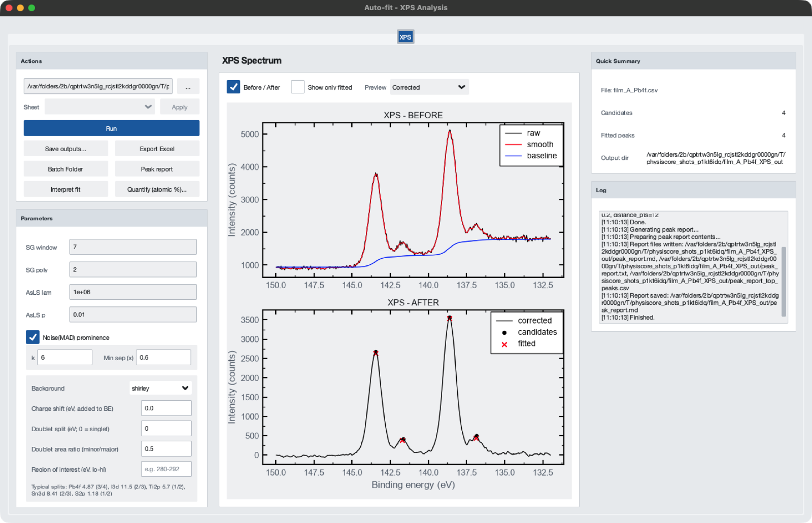

*Pb 4f region with a metallic shoulder: Shirley baseline (top) and the four fitted components on the corrected spectrum (bottom); the binding energy decreases to the right. Synthetic example data.*

**Auto-fit workspace** (PL, XRD, XPS) - a parameter-driven pipeline: Savitzky-Golay
smoothing, background, noise-adaptive peak detection and Voigt fitting; *Before / After*
shows the processing steps; *Batch Folder* runs the same parameters over every file of a
folder and writes `summary.xlsx`; *Peak report* writes a Markdown report with the
rule-based findings; **Interpret fit** shows them in a window (detection and
quantification limits, unresolved neighbours, residual against noise, then the XRD, PL or
XPS rules - section 18).

Each Voigt component has both its Gaussian and its Lorentzian width fitted. Up to 3.5.1
the Lorentzian width was held at its starting value, which made XPS and XRD auto-fit areas
3 to 36 % too high: fit such tables again with 3.5.2 or later (METHODS section 9). The
smoothing finds the peaks; since 3.5.3 the lines are fitted to the unsmoothed data minus
the background, drawn in grey ("raw - baseline") under the smoothed curve in the *Corrected + Fit* view (up
to 3.5.2 the fit used the smoothed curve, and the XRD default of 31 points widened narrow
reflections by up to 174 %: take Scherrer sizes from a 3.5.3 table). The S/N column and
the **Interpret fit** limits use the noise of those unsmoothed data; before 3.5.3 they
used the much smaller noise of the smoothed curve, so S/N was overstated. In the XRD
workspace each reflection's window stops halfway to a neighbouring reflection. XRD areas
come out 5 to 10 % low because the baseline follows part of the line tails; compare areas
between patterns processed with the same settings (METHODS section 5).

XPS block: **Background** (Shirley by default, or AsLS), **Charge shift** (eV added to
every binding energy, e.g. 284.8 minus the measured C 1s), **Doublet split** and **area
ratio** (0 for s levels; typical values are listed in the panel), **Region of interest**.
With a doublet split, a peak one split above a stronger peak is taken as its partner line,
and overlapping doublets are fitted together; the table gives each doublet a
`doublet_id` (3.5.3; before, every peak was fitted as the first line of its own doublet).
**Quantify (atomic %)** assigns each fitted peak to a core level and computes atomic
concentrations with Scofield factors (or the factors of your instrument).

## 13. Transport and recombination tools

Six tools (new in 3.5) cover the measurements that explain why a device performs as it
does: space-charge-limited current, light-intensity dependence, time-resolved PL,
impedance, capacitance-voltage and stability traces. They share one window layout and
behave the same way; only the parameters, the views and the numbers differ. Everything
is computed on this computer from the equations of METHODS §17-§22.

### 13.1 What the six windows share

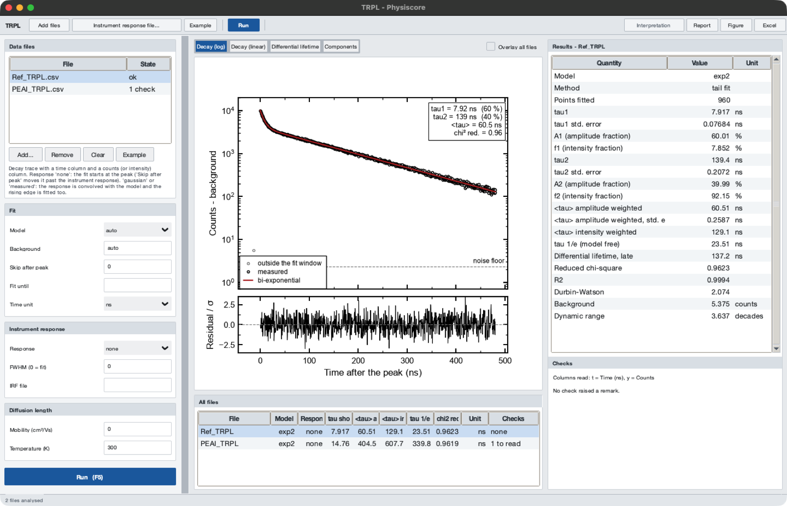

*The TRPL window with the built-in example. Left: files and parameters. Centre: the view
selector, the graph and the table of all files. Right: every result of the selected file
and the validity checks. Synthetic example data.*

- **Data files** (left, top): *Add...* (Ctrl+O, several files at once), *Remove*, *Clear*
  and *Example*. Each file is one row with its state: *not run*, *ok*, *n checks*
  (analysed, with that many validity remarks) or *error* (the reason is shown on the
  right). *Example* loads a curve produced by the tool's own model with known
  parameters; it is labelled "Synthetic example" wherever it appears, including the
  exports, so it cannot be mistaken for a measurement.
- **Parameters** (left, below): grouped as in the tables of the following sections. An
  empty field means *automatic* (or *from Settings* for the device area). The values are
  remembered per tool.
- **Run** (F5) analyses every file of the list with the same parameters, one file after
  the other; the status bar shows the progress. A file that cannot be analysed is marked
  with the reason and the run continues with the next one.
- **Graph** (centre): the selector above the graph switches between the views of the
  tool. **Overlay all files** draws the other files of the list behind the selected one.
  The graph tools of section 2 (data reader, plot details, journal-size export, data
  worksheet) work in every view.
- **All files** (centre, bottom): one row per file with the key numbers and the checks;
  selecting a row shows that file. Right-click copies the table.
- **Results** (right): every quantity of the selected file with its unit and, where the
  fit gives one, its standard error. **Checks** (right, bottom): the validity remarks of
  the method in plain sentences - what limits the number and what to measure instead.
- **Exports**: *Excel* (Ctrl+E) writes the sheets `Summary` (one row per file),
  `Results` (every quantity of every file), `Checks` and `Parameters`, plus the curves
  and fits of up to 20 files on their own sheets, with a side-car (section 16).
  *Figure*, *Report* and *Interpretation* work as in every window (sections 2 and 18).
- A file that reads, with high confidence, as another kind of measurement (an impedance
  spectrum given to TRPL) is still analysed, and the check list says what it looks like.
- *Help → Methods of this tool* opens the offline method notes at the section of the tool.

The same analyses run without the window: `physiscore_cli.py sclc | intensity | trpl |
eis | cv | stability` (CLI.md).

### 13.2 SCLC

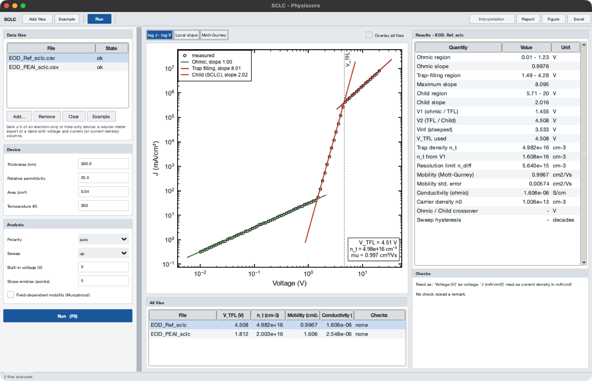

*log J - log V of a single-carrier device with the ohmic, trap-filling and Child regions
and their tangents. Synthetic example data.*

Dark current-voltage curve of an **electron-only or hole-only** device. Input: a
source-meter export (the whole `Vmeas / Imeas` block is read, not only −3…3 V) or any
table with voltage and current (or current density) columns.

| Group | Parameter | Meaning |
|---|---|---|
| Device | Thickness (nm) | thickness L of the layer between the contacts; enters n_t as 1/L² and μ as L³ |
| Device | Relative permittivity | ε_r of the layer (25 by default) |
| Device | Area (cm²) | converts a current to a current density; empty = the device area of Settings |
| Device | Temperature (K) | used for the resolution limit n_diff |
| Analysis | Polarity | *auto* (the branch with more points), *positive* or *negative* |
| Analysis | Sweep | *up*, *down* or *all* points of a forward-and-back sweep |
| Analysis | Built-in voltage (V) | V − V_bi is analysed when the contacts are asymmetric |
| Analysis | Slope window (points) | points of the moving fit that gives the local slope (5) |
| Analysis | Field-dependent mobility (Murgatroyd) | also fits μ₀ and γ of the Poole-Frenkel form |

Views: **log J - log V** (data, the three fitted regions and V₁, V₂, V_inf), **Local
slope** (d log J / d log V with the bands 1 = ohmic and 2 = Child), **Mott-Gurney**
(J against V², a straight line in the Child region).

Results: the voltage range and slope of the ohmic, trap-filling and Child regions; V₁,
V₂, V_inf and the V_TFL used; trap density n_t (and n_t from V₁); the resolution limit
n_diff; the Mott-Gurney mobility with its standard error; the ohmic conductivity and the
carrier density n₀; the sweep hysteresis in decades.

Checks to take seriously: *no Child region* (no mobility can be given), *n_t below
n_diff* (the rise comes from diffusion of injected carriers, not from traps), *hysteresis
above 0.1 decades* (mobile ions; pulsed or fast sweeps are needed). In mixed
ionic-electronic conductors both n_t and μ are estimates, and the report says so.

### 13.3 Light intensity

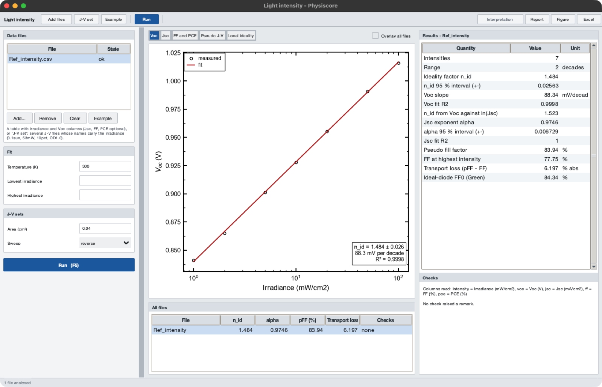

*Voc against irradiance with the fitted ideality factor. Synthetic example data.*

Voc, Jsc and FF against irradiance. Two kinds of input:

- **Add files**: a table with irradiance and Voc columns; Jsc, FF and PCE are optional
  (without Jsc only the ideality factor from Voc is given).
- **J-V set**: several illuminated J-V files measured at different intensities. Each is
  analysed with the J-V routine of section 3, and the irradiance is read from the file
  name: `cell_0.1sun.txt`, `cell_0p5suns.txt`, `cell_53mW.txt`, `cell_10pct.txt`,
  `cell_OD1.0.txt` (a filter of optical density 1). At least three files must carry one.

| Group | Parameter | Meaning |
|---|---|---|
| Fit | Temperature (K) | kT/q of the ideality factor |
| Fit | Lowest / Highest irradiance | fit window; points outside are drawn but not fitted |
| J-V sets | Area (cm²) | area of the J-V files; empty = Settings |
| J-V sets | Sweep | *reverse*, *forward* or *combined* scan of each J-V file |

Views: **Voc** (against ln I with the fitted line), **Jsc** (log-log, exponent α), **FF
and PCE**, **Pseudo J-V** (the Suns-Voc curve without series resistance next to the
values at the highest intensity), **Local ideality** (n_id between neighbouring
intensities).

Results: n_id with its 95 % interval, the Voc slope in mV per decade and R²; n_id from
Voc against ln Jsc (independent of the intensity calibration); α with its interval; the
pseudo fill factor, the FF at the highest intensity, the transport loss pFF − FF and
Green's ideal-diode FF₀.

Reading the numbers (the interpretation applies the same ranges, section 18): n_id of
0.9-1.2 means free-carrier recombination, or a surface where one carrier is in excess;
1.2-1.8 trap-assisted recombination with unequal carrier densities, in perovskite cells
usually at the interfaces; 1.8-2.2 Shockley-Read-Hall recombination through deep states
in the bulk. Values outside 0.9-2.2 mean that the points are not on one line (shunt at
low light, series resistance or heating at high light) - restrict the fit window. α of
0.97 or more is a current that follows the light; below 0.9 a loss grows with intensity
(bimolecular recombination or space charge at short circuit).

### 13.4 TRPL

Decay trace from time-correlated single-photon counting or a streak camera: a time
column and a counts (or intensity) column. The fit starts at the maximum of the decay
(tail fit, no deconvolution of the instrument response).

| Group | Parameter | Meaning |
|---|---|---|
| Fit | Model | *auto* (1, 2 or 3 exponentials chosen by AICc), *exp1*, *exp2*, *exp3*, *stretched* |
| Fit | Background | *auto* (points before the pulse, otherwise a flat tail), *none* or a number of counts |
| Fit | Skip after peak | time left out after the maximum (in the time unit), e.g. the response width |
| Fit | Fit until | end of the fit window; empty = the whole trace |
| Fit | Time unit | unit of the time column: ps, ns, us, ms, s |
| Fit | IRF FWHM | width of the instrument response; lifetimes below it are flagged |
| Diffusion length | Mobility (cm²/Vs) | with a value, L_D = √(μ kT/q · ⟨τ⟩) is reported |
| Diffusion length | Temperature (K) | kT/q of the diffusion coefficient |

Views: **Decay (log)** and **Decay (linear)** with the fit and the weighted residuals,
**Differential lifetime** (τ_diff(t) = −(d ln I/dt)⁻¹, model-free), **Components** (the
individual exponentials).

Results: the model used, every lifetime with its standard error, amplitude fraction and
intensity fraction; ⟨τ⟩ amplitude-weighted and intensity-weighted; the model-free 1/e
time; the late differential lifetime; reduced χ², R², the Durbin-Watson statistic; the
background and the dynamic range; the diffusion length when a mobility is entered.

Which lifetime to quote: the amplitude-weighted ⟨τ⟩ is proportional to the
time-integrated emission and is the one to compare between samples; the
intensity-weighted ⟨τ⟩ is the mean emission time and is always longer. State which one a
number is. A lifetime longer than half the fit window, or a dynamic range below 1.5
decades, is flagged because the fit cannot determine it.

### 13.5 Impedance

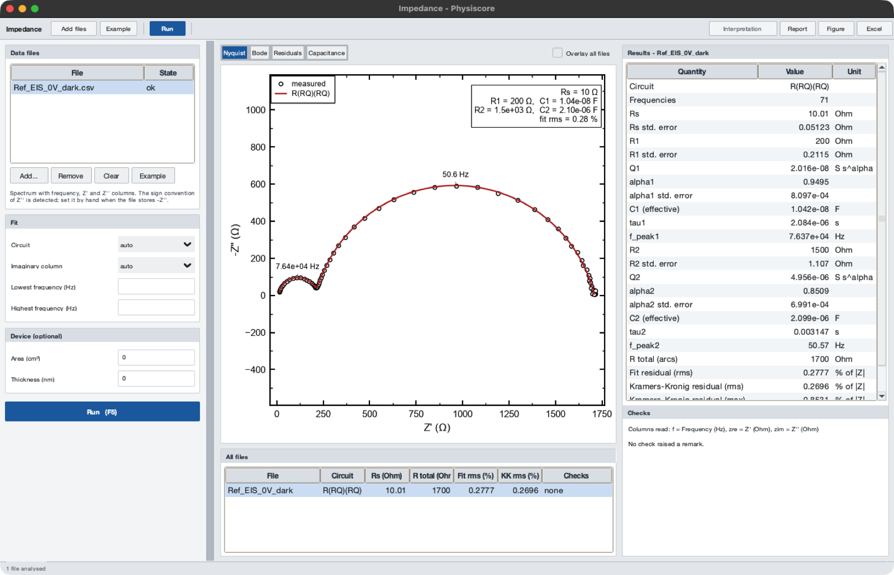

*Nyquist plot with the fitted R(RQ)(RQ) circuit; the Kramers-Kronig residuals are in the
view "Residuals". Synthetic example data.*

Impedance spectrum with three columns: frequency (Hz), Z′ and Z″ (Ohm). Files that store
−Z″ are recognised.

| Group | Parameter | Meaning |
|---|---|---|
| Fit | Circuit | *auto* (chosen by AICc) or R(RC), R(RQ), R(RC)(RC), R(RQ)(RQ); Q is a constant-phase element |
| Fit | Imaginary column | *auto*, `Z''` or `-Z''` |
| Fit | Lowest / Highest frequency (Hz) | fit window |
| Device (optional) | Area (cm²) | gives R × area and C / area |
| Device (optional) | Thickness (nm) | with the area, ε_r from the capacitance of the fastest arc |

Views: **Nyquist** (−Z″ against Z′ with equal axes), **Bode** (|Z| and phase),
**Residuals** (circuit and Kramers-Kronig residuals in % of |Z|), **Capacitance**
(C(f) = Im(1/Z)/ω).

Results: the circuit; Rs; for each arc R, Q, α, the effective capacitance, the time
constant and the peak frequency, with standard errors; the total arc resistance; the rms
residual of the circuit; the rms and maximum residual of the Kramers-Kronig test and the
number of RC elements it used.

The **Kramers-Kronig test** comes first: a spectrum that fails it (maximum residual
above 2 %) was not stationary during the sweep - usually drift at low frequency - and no
circuit fitted to it means anything. Measure faster, start at high frequency, or let the
device settle. In perovskite cells the low-frequency arc is ionic and must not be read
as a recombination resistance.

### 13.6 C-V (Mott-Schottky)

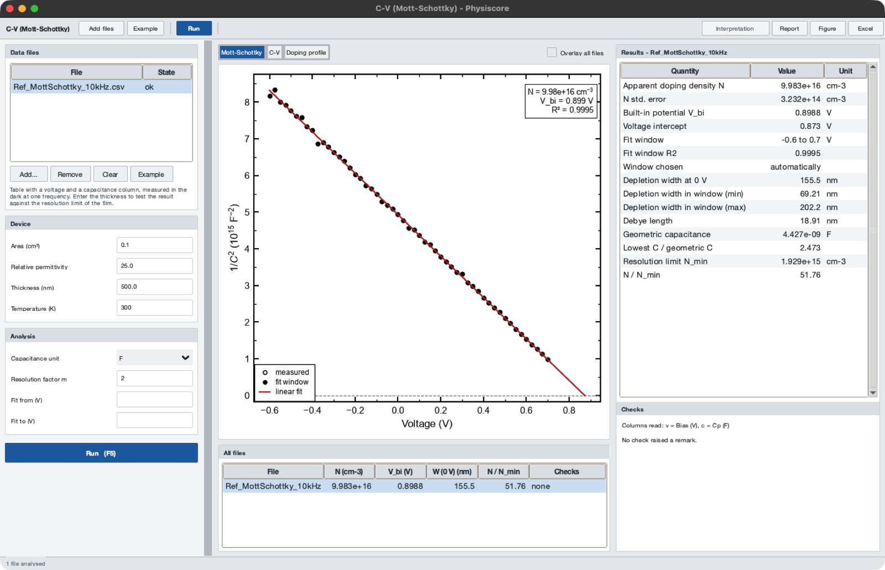

*1/C² against voltage with the automatically chosen straight section. Synthetic example
data.*

Capacitance against DC bias, measured in the dark at one frequency: a voltage column and
a capacitance column.

| Group | Parameter | Meaning |
|---|---|---|
| Device | Area (cm²) | enters N as 1/A²; empty = Settings |
| Device | Relative permittivity | ε_r (25 by default) |
| Device | Thickness (nm) | layer thickness; needed for the geometric capacitance and the resolution limit N_min |
| Device | Temperature (K) | kT/q in V_bi and N_min |
| Analysis | Capacitance unit | unit of the capacitance column: F, mF, uF, nF, pF |
| Analysis | Resolution factor m | m of N_min = 27 m kT ε/(4 q² d²) (2 by default) |
| Analysis | Fit from / Fit to (V) | straight section by hand; empty = the widest straight section is found automatically |

Views: **Mott-Schottky** (1/C² against V with the fitted line and its intercept),
**C-V**, **Doping profile** (N against depletion width).

Results: the apparent doping density N with its standard error, V_bi, the fit window
and its R², the depletion width at 0 V and over the window, the Debye length, the
geometric capacitance, N_min and the ratio N / N_min.

**Enter the thickness.** Without it the resolution limit cannot be tested, and a thin,
undoped, fully depleted layer gives a straight Mott-Schottky line whose "doping density"
is only the geometric capacitance in disguise. When N is below 3 N_min the check list
says that the line is not evidence of doping.

### 13.7 Stability

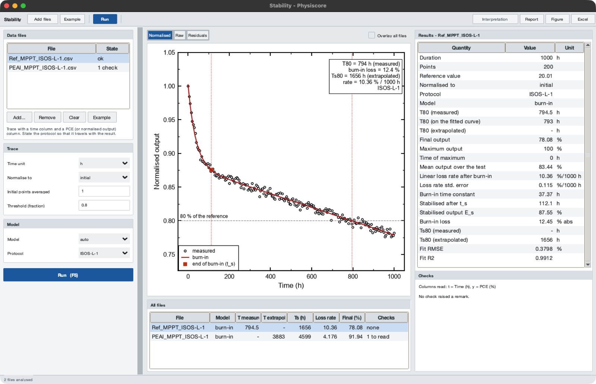

*A trace with burn-in: the fitted burn-in model, the 80 % level and the T80 crossing.
Synthetic example data.*

Efficiency, power or normalised output against time (maximum-power-point tracking or
repeated J-V scans): a time column and a value column.

| Group | Parameter | Meaning |
|---|---|---|
| Trace | Time unit | unit of the time column: s, min, h, day |
| Trace | Normalise to | *initial* (mean of the first points), *maximum* or *none* |
| Trace | Initial points averaged | number of points that define the initial value |
| Trace | Threshold (fraction) | 0.8 for T80, 0.9 for T90 ... |
| Model | Model | *auto* (AICc) or linear, exponential, burn-in, bi-exponential |
| Model | Protocol | the ISOS protocol of the test (ISOS-D-1/2/3, ISOS-L-1/2/3, ISOS-T-1, ISOS-O-1, ISOS-V-1, ISOS-LC-1, MPP tracking) or *not stated*; written into the report and the side-car |

Views: **Normalised** (trace, fitted model, threshold and crossing), **Raw**,
**Residuals**.

Results: duration and number of points; the reference value and what it was normalised
to; the model; T80 **measured** (the trace crossed the level), T80 on the fitted curve,
or T80 **extrapolated** (the level was not reached; the model is followed beyond the
measurement); final, maximum and mean output; the linear loss rate in %/1000 h with its
standard error; with the burn-in model the burn-in time constant, the stabilised point
t_s and output E_s, the burn-in loss and Ts80 (the lifetime counted from t_s).

An extrapolated lifetime is always labelled as extrapolated - in the window, the Excel
file, the report and the interpretation - together with the ratio to the measured time.
Report it as an estimate, and name the protocol: a T80 without conditions cannot be
compared with another laboratory's.

## 14. Workspace folder and results index

The two tabs **Workspace** and **Results** of the main window (new in 3.5) turn a
measurement folder into a project: what was measured, and what has been analysed so far.

### 14.1 Workspace

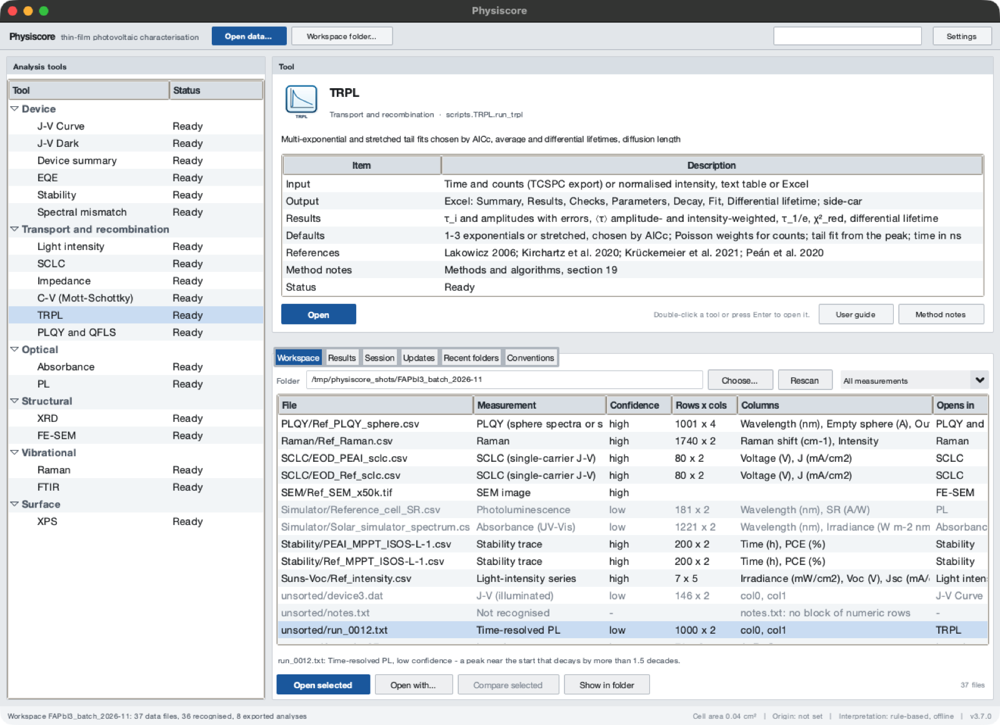

*The Workspace tab with a project folder: each data file with the measurement it holds,
the confidence of that reading and the tool that opens it. Synthetic example data.*

Choose the folder with **Workspace folder...** in the toolbar (Ctrl+Shift+O), with
*Choose...* in the tab, or type the path into *Folder* and press Enter. The folder is
remembered between sessions and shown in the Session tab. **Rescan** reads it again.

Every data file up to two folder levels down is listed (text tables, Excel workbooks and
SEM images; hidden files, lock files and workbooks that Physiscore exported are left
out):

| Column | Content |
|---|---|
| File | name, relative to the workspace folder |
| Measurement | what the file holds: J-V, dark J-V, SCLC, EQE, absorbance, PL, TRPL, XRD, Raman, FTIR, XPS, impedance, C-V, light-intensity series, stability trace, SEM image - or *Not recognised* |
| Confidence | *high*, *medium* or *low* (low-confidence rows are greyed) |
| Rows x cols | size of the numeric table |
| Columns | the column names found in the file |
| Opens in | the tool that analyses it |

Click a heading to sort; the menu at the top right filters by measurement. The line
under the table gives the **evidence** for the selected file - which word of the name,
which column names and which properties of the numbers led to the reading - and the
other measurements the file could be.

- **Open selected** (double-click or Enter): opens the file in its tool. Several
  selected files of the same kind open together in one window, as a batch.
- **Open with...**: choose the tool yourself, for a file that was not recognised or was
  read wrongly.
- **Compare selected**: EQE, absorbance, PL, XRD, Raman or FTIR spectra go to the
  Compare window (section 15).
- **Show in folder**; the right-click menu also has *Copy path*. Ctrl+A selects all.

How a file is recognised: the detector adds up evidence from the file name, the column
names and the numbers themselves (METHODS §23). It is a fixed list of scored rules - no
model is trained, nothing is sent anywhere - and it only ever suggests a tool: the
analysis is the same whichever way the file was opened.

### 14.2 Open data

**Open data...** (toolbar, *File* menu, Ctrl+O) is the same recognition for files picked
in a dialog, and `Physiscore --open FILE ...` for files given on the command line. The
files of the first file's kind open together in its tool. When the reading is missing or of low confidence, the **Open with** dialog shows
what the file looks like and why, and asks for the tool. If only part of a mixed
selection was opened, the status bar says how many files went to the tool. J-V Curve and
J-V Dark work on folders, so they open with the folder of the file.

### 14.3 Results

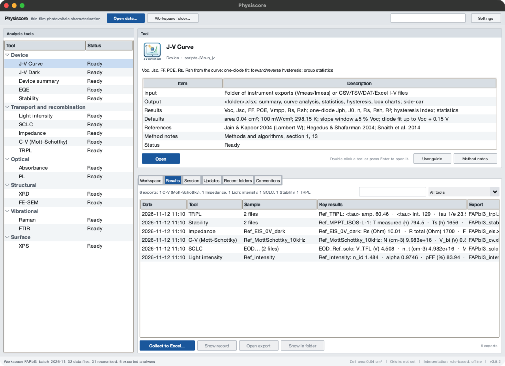

*The Results tab: every export below the workspace folder with its key numbers.
Synthetic example data.*

The Results tab lists every analysis exported below the workspace folder (up to four
levels down). It reads the side-car files (section 16) that accompany each Excel export;
nothing is analysed again.

| Column | Content |
|---|---|
| Date | date and time of the export |
| Tool | the analysis tool |
| Sample | the input file (for several inputs their common name and the number of files) |
| Key results | the first numbers of the export - of its first sample when it holds several, with the number of further samples |
| Export | the workbook that was written |

*Filter by sample* and the tool menu narrow the list; a click on a heading sorts it.

- **Show record** (double-click or Enter): everything the side-car records - inputs,
  every parameter and every number, the program version and date.
- **Open export** opens the workbook, **Show in folder** its folder.
- **Collect to Excel...** (also *File → Collect results to Excel...*) writes one workbook
  with the sheet `Index` (the list above), one sheet per tool with a row per export and a
  column per result, and `All values` in long form (table, row, quantity, value) for
  pivot tables. It is the table a group meeting or a supplementary file needs: every
  sample of a batch with its J-V, EQE, TRPL and stability numbers side by side.

The command line does the same: `physiscore_cli.py detect FOLDER` and
`physiscore_cli.py collect FOLDER --out results.xlsx` (CLI.md).

## 15. Comparing many files

*Four EQE spectra of a composition series analysed side by side. Synthetic example data.*

**Compare files** (EQE, Absorbance, PL, XRD, Raman, FTIR) opens a window in which you
add files or a whole folder (optionally every column of each file). Each spectrum is
analysed with the same function as the batch command, the results are tabulated side by
side and the spectra overlaid; *Normalise* (none / max / area) and *Offset* make stacked
figures; *Energy axis* converts EQE, absorbance and PL to eV. Excel exports the table and
every spectrum (one sheet each) with a side-car.

The command `physiscore_cli.py batch` does the same without the GUI (see CLI.md).

## 16. Outputs, reports and side-car files

Every Excel export is accompanied by `<name>.analysis.json`, a side-car that records the
program version, date and time, Python and platform, the input files, every analysis
parameter (area, thresholds, windows, models, references) and the main results. It lets
a number in a manuscript be traced to the exact analysis and lets scripts re-run or
compare analyses. Files with a side-car are recognised as outputs and are never read back
as inputs.

The side-cars are also what the **Results** tab and *Collect results to Excel* read
(section 14.3): keep them next to the workbooks, and a whole project can be tabulated at
any later time without opening a single analysis again.

## 17. Settings

**File → Settings** in the main window:

| Setting | Effect |
|---|---|
| Device active area (cm²) | current density = current / area; scales Jsc and PCE linearly; read again for every analysis |
| OriginLab executable | enables the Origin buttons (Windows) |
| Appearance | Light (default) or Dark; applies after a restart (graphs stay white, as in Origin) |
| Plot colours | Origin (default: black, red, blue, magenta, olive, navy ...) or Colour-blind safe (Okabe-Ito); applies after a restart |

The workspace folder (section 14) and the parameters of the transport tools (section 13)
are remembered in the same file without a dialog.

Settings live in `physisfera_config.json` (installed copies: the per-user folder,
**File → Open settings folder**). `PHYSISCORE_CONFIG` points to another file;
`PHYSISCORE_THEME=dark` overrides the appearance for one run; `PHYSISCORE_NO_UPDATE=1`
disables the update check.

## 18. Interpretation

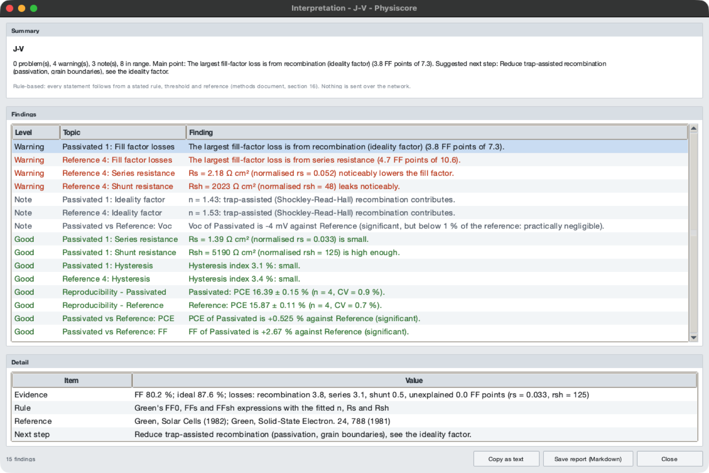

*Interpretation of a J-V batch: summary (top), findings worst first (middle), and the
evidence, rule, reference and next step of the selected finding (bottom). Synthetic
example data.*

Every analysis window has **Interpretation** at the right end of the toolbar (also
*Analysis → Interpretation*). It reads the results already on screen and lists findings,
worst first:

| Level | Meaning |
|---|---|
| Problem | limits the device or invalidates a number |
| Warning | worth acting on |
| Note | context worth reporting |
| Good | within the expected range |

Selecting a finding shows its **evidence** (the numbers it came from), the **rule**
(threshold or formula), the **reference** and a suggested **next step**. *Copy as text* puts the
whole report on the clipboard; *Save report (Markdown)* writes it to a file for a lab notebook or
the supplementary information.

| Window | What is checked |
|---|---|
| J-V Curve | fill-factor loss split (recombination, series, shunt; Green), ideality factor, normalised Rs and Rsh, S-shape, hysteresis index; between conditions: CV, outliers (modified z-score), Welch t-test with Holm correction and Hedges' g |
| J-V Dark | dark ideality factor, leakage (dark Rsh), Rs, fit quality |
| EQE | Urbach energy, Jsc against the detailed-balance limit, where the current is lost (AM1.5G-weighted), peak EQE, radiative and non-radiative voltage losses (EQE_EL) |
| Absorbance | linearity and width of the Tauc region, the other transition type, edge position |
| PL | line width (also in kT), quenching or enhancement against the reference, peak and Stokes shifts, extra bands |
| XRD | Scherrer sizes, Williamson-Hall strain, phase coverage and shift, unassigned reflections against common secondary phases (PbI₂, δ-phase, substrate lines), texture coefficient, crystallinity |
| FE-SEM | sample size, width, bimodality, log-normal shape, small-grain fraction, process hints |
| Raman / FTIR | band list, library assignments, functional groups, shifts and width changes against the reference |
| XPS (auto-fit) | metallic Pb, Pb 4f doublet ratio and split, broad components, C 1s charge reference, O 1s caution, detection limits |
| Device summary | Jsc cross-check, band-gap agreement, fractions of the detailed-balance limit, voltage-loss split |
| SCLC | whether a Mott-Gurney region exists and has slope 2, trap density against the resolution limit n_diff, sweep hysteresis (mobile ions), ohmic conductivity |
| Light intensity | ideality factor and its uncertainty, Jsc exponent α, transport loss in the fill factor (pFF − FF), pseudo fill factor |
| TRPL | fit quality (reduced χ², Durbin-Watson), the decay law and what its lifetimes mean, the two average lifetimes, the differential lifetime, diffusion length |
| Impedance | Kramers-Kronig test, circuit residual, assignment of the arcs, CPE exponent, permittivity |
| C-V | whether a Mott-Schottky region exists, doping density against the resolution limit N_min, built-in potential, depletion width against the thickness, doping profile |
| Stability | T80 reached or extrapolated (and how far), burn-in loss and Ts80, loss rate |

The rules, thresholds and references are listed in
[METHODS §16](METHODS.md#16-rule-based-interpretation-scriptscommoninterpretpy-interpret_transportpy). They are
screening values from the literature, not pass/fail criteria for every material; the
interpretation never changes a number and needs no account or network.

## 19. Troubleshooting

| Symptom | What to check |
|---|---|
| A J-V folder gives "No valid data found" | the files need a `Vmeas / Imeas` block, or a CSV/Excel layout with voltage and current columns (FILE_FORMATS §1) |
| PCE values are off by a constant factor | the device area in Settings |
| The Jsc mismatch in Device summary is large | spectral mismatch factor of the simulator, lamp calibration, area, or EQE measured on a different cell |
| The EQE band gap looks wrong | EQE must be in % or as a fraction against wavelength in nm, ascending or descending |
| Auto fit finds no Tauc region | choose Direct/Indirect correctly, enter an expected gap, or drag the range by hand |
| XRD peaks are missing | lower the noise level of the pattern or use *Fit range* on the region; check that 2θ is in degrees |
| The Origin buttons do nothing | Windows only; set the Origin path in Settings; Origin must be installed with its automation server |
| macOS refuses to open the app | System Settings → Privacy & Security → Open Anyway (INSTALL.md) |
| Results differ from an older version | check the side-car of both exports: the parameters (area, windows, models) are listed there |
| A file is listed as *Not recognised*, or opens in the wrong tool | use *Open with...* and choose the tool; a telling word in the file name (`trpl`, `eis`, `sclc`, `mott`, `mppt`, `dark` ...) or column headings make the reading certain (section 14.1) |
| The Workspace tab is empty | the folder holds no text tables, workbooks or SEM images within two levels, or only workbooks that Physiscore exported (those are under Results) |
| The Results tab is empty | nothing has been exported below the workspace folder yet, or the `.analysis.json` side-cars were removed |
| SCLC gives no mobility | there is no region with slope 2: measure to higher voltage; if the slope never settles at 2 the device is not single-carrier or its contacts limit the current (section 13.2) |
| The trap density is flagged as below n_diff | the rise is diffusion of injected carriers, not trap filling; the number is not a trap density (a thicker layer lowers the limit as 1/L²) |
| A J-V set is refused: fewer than three files carry an irradiance | name the files with the intensity (`cell_0.1sun.txt`, `cell_53mW.txt`, `cell_OD1.0.txt`) or make a table with irradiance and Voc columns (section 13.3) |
| TRPL: reduced χ² far above 1.3 | the model has too few terms, or the first points after the peak still contain the instrument response: try the next model, or set *Skip after peak* |
| Impedance: the Kramers-Kronig test fails | the device changed during the sweep; the circuit values are not meaningful (section 13.5) |
| C-V: N is below or near N_min | the layer is fully depleted; the straight line is the geometric capacitance, not doping. Check the thickness, unit and area (section 13.6) |
| T80 is "extrapolated" | the trace did not reach the level; the value comes from the fitted model and is an estimate (section 13.7) |

Bugs and requests: <https://github.com/jongsu-king/physiscore/issues> (please attach
the side-car and, if you can, a data file).
